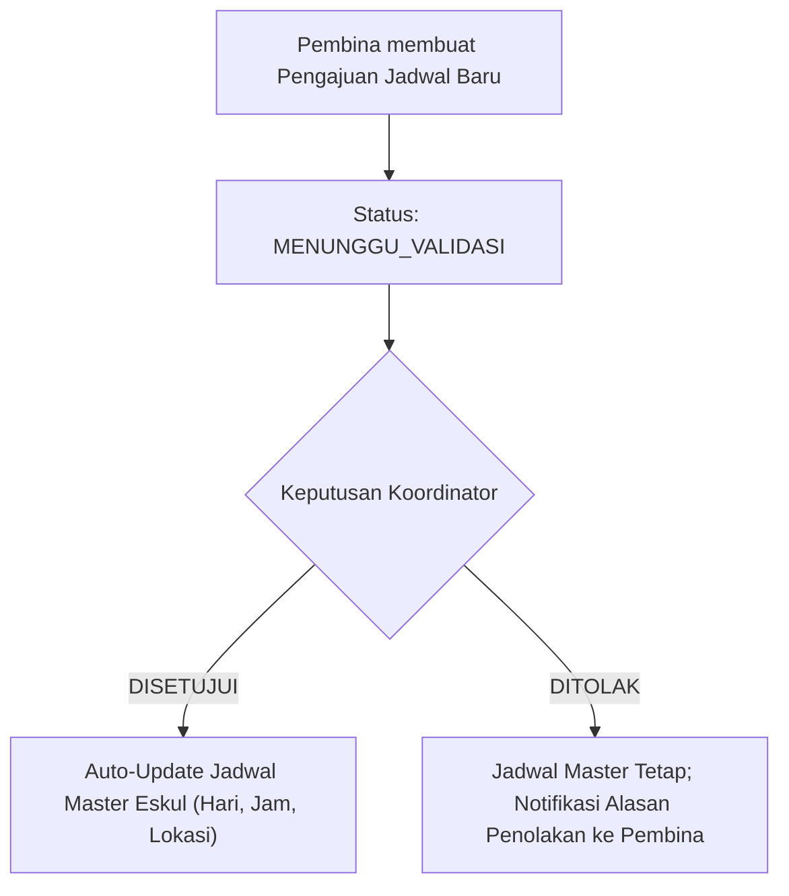
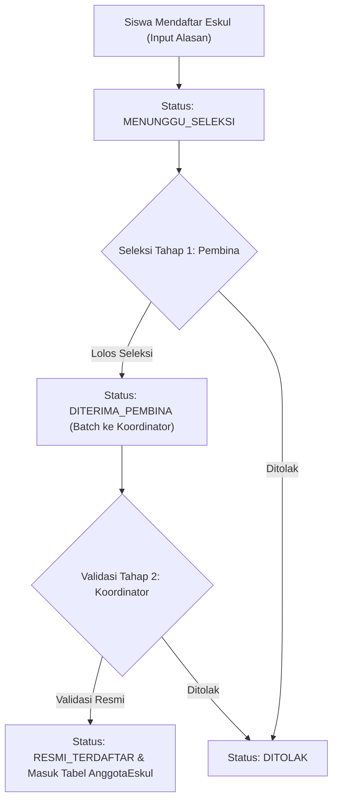
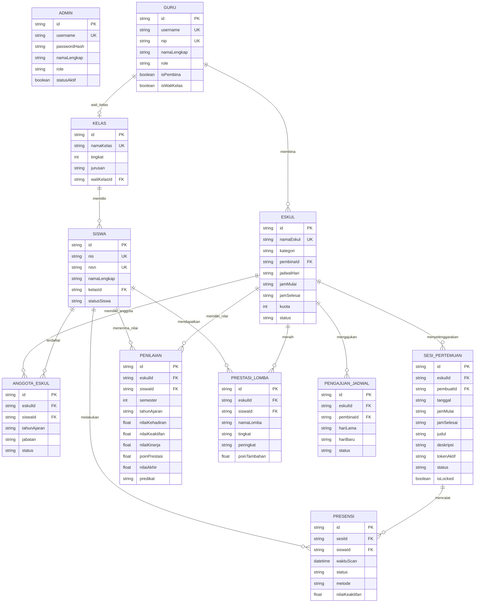

# PRODUCT REQUIREMENT DOCUMENT (PRD)
## SISTEM INFORMASI PRESENSI DYNAMIC QR & PENILAIAN EKSTRAKURIKULER
### SMK AL AMANAH KOTA TANGERANG SELATAN

---

## 1. EXECUTIVE SUMMARY & LATAR BELAKANG

### 1.1 Identitas Produk
* **Nama Produk:** Sistem Informasi Presensi Dynamic QR & Penilaian Ekstrakurikuler SMK Al Amanah
* **Institusi:** SMK Al Amanah Kota Tangerang Selatan (NPSN: 20614829)
* **Kategori Solusi:** School Information System / Extracurricular Activity & Attendance Management
* **Platform:** Web Responsive (Desktop, Tablet, & Mobile PWA-Ready)

### 1.2 Problem Statement
Sebelum sistem ini diimplementasikan, pengelolaan ekstrakurikuler di SMK Al Amanah menghadapi masalah operasional kritis:
1. **Titip Absen & Manipulasi Kehadiran:** Presensi manual berbasis tanda tangan kertas dan presensi QR statis rentan disalahgunakan melalui foto QR yang disebarkan via WhatsApp atau titip absen antarteman.
2. **Ketiadaan Pembatasan Lokasi:** Siswa dapat melakukan presensi dari luar sekolah atau dari rumah tanpa pengawasan fisik.
3. **Silo Manajemen Jadwal:** Perubahan jadwal latihan antar-pembina sering bertabrakan dengan fasilitas lapangan/lab karena ketiadaan alur pengajuan dan validasi resmi dari Koordinator Kesiswaan.
4. **Penilaian Subjektif & Lambat:** Rekap nilai akhir semester sering terlambat dan tidak transparan, tidak memiliki formula pembobotan matematis standar yang memadukan kehadiran, keaktifan lapangan, kinerja, dan perolehan juara lomba.
5. **Akses Data Wali Kelas & Siswa Minim:** Wali kelas kesulitan memantau keaktifan siswa perwaliannya, dan siswa tidak memiliki kartu digital terpadu untuk menunjukkan keanggotaan dan riwayat presensi mereka.

### 1.3 Solusi Produk
Sistem digital terpadu yang memadukan:
* **Dynamic Rolling QR Code (rotasi 15 detik)** berbasis window waktu kriptografis dan salt random untuk mencegah tangkapan layar/titip absen.
* **Geofencing GPS Radius Sekolah** yang memvalidasi radius siswa terhadap koordinat sekolah (-6.34215, 106.71124) maksimal 150 meter.
* **Alur Validasi Bertingkat (Two-Tier Governance)** untuk pengajuan jadwal latihan dan pendaftaran anggota baru.
* **Kalkulasi Nilai Otomatis 4-Komponen** (Kehadiran 40%, Keaktifan 25%, Kinerja 25%, Prestasi/Bonus 10%) berstandar e-Rapor Kurikulum Merdeka.
* **Dual Scanning Mode** (Siswa scan QR guru & Guru scan QR kartu identitas digital siswa).

---

## 2. USER PERSONAS & ROLE-BASED ACCESS CONTROL (RBAC)

Sistem menerapkan pembatasan hak akses berbasis peran (RBAC) yang ketat pada layer server dan tampilan UI:

| Role | Representasi Pengguna | Hak Akses Utama | Batasan & Guardrails |
| :--- | :--- | :--- | :--- |
| **`ADMIN`** | Administrator IT Sekolah (`admin`, `admin.it`) | Full Control: Kelola seluruh akun, master data eskul/kelas/siswa/guru, konfigurasi geofencing sekolah, reset password, audit sistem. | Tidak melakukan penilaian langsung lapangan; fokus pada operasional infrastruktur. |
| **`KOORDINATOR`** | Koordinator Ekstrakurikuler & Wakasek Kesiswaan | Monitoring lintas seluruh cabang eskul, persetujuan/penolakan pengajuan jadwal eskul, validasi akhir pendaftaran anggota baru, ekspor laporan sekolah. | Menjadi penentu kebijakan manajerial dan persetujuan bertingkat. |
| **`PEMBINA`** | Guru Pembina Cabang Eskul (Futsal, Web, Hadroh, dll.) | Membuka sesi presensi (Dynamic QR / Checklist), seleksi pendaftaran anggota baru tahap 1, input nilai 4-komponen, pengajuan perubahan jadwal, kelola anggota eskul. | **Hanya dapat mengakses dan mengelola eskul yang diampunya** (Defense against IDOR). Tidak bisa memvalidasi pengajuannya sendiri. |
| **`WALI_KELAS`** | Guru Wali Kelas (X RPL 1, XI TKJ 2, dll.) | Dashboard monitoring perwalian, rekap kehadiran eskul siswa di kelasnya, unduh lembar penilaian perwalian untuk integrasi e-Rapor. | Tidak dapat mengubah jadwal eskul atau membuka sesi absensi eskul. |
| **`SISWA`** | Peserta Didik SMK Al Amanah | Pendaftaran cabang eskul, kamera scanner dynamic QR pembina, akses Kartu Identitas Siswa Digital dengan QR statis, riwayat kehadiran, melihat rapor nilai eskul & piagam prestasi. | Tidak memiliki akses ke dashboard pengelolaan atau modifikasi nilai. |

---

## 3. ARSITEKTUR SISTEM & TECH STACK

```
┌────────────────────────────────────────────────────────┐
│                   FRONTEND CLIENT                      │
│      React 19 + TypeScript + Vite + Tailwind CSS       │
│    Framer Motion (Micro-interactions) + Lucide Icons   │
│         HTML5-QRCode + Canvas Confetti                 │
└───────────────────────────▲────────────────────────────┘
                            │ REST API (JSON / Bearer JWT)
┌───────────────────────────▼────────────────────────────┐
│                  BACKEND API SERVER                    │
│        Node.js (ESM) + Express.js + Prisma ORM         │
│  OWASP Security Middleware + CORS Whitelist + Bcrypt   │
└───────────────────────────▲────────────────────────────┘
                            │ Query Engine
┌───────────────────────────▼────────────────────────────┐
│                    DATABASE LAYER                      │
│        SQLite (dev.db) / PostgreSQL Compatible         │
│     Prisma Migrations + Automated Seeding Logic        │
└────────────────────────────────────────────────────────┘
```

* **Frontend:** React 19.x, TypeScript 5.x, Vite 8.x, Tailwind CSS v3, Radix UI Primitives, Lucide React, Framer Motion.
* **Backend:** Node.js v20+, Express.js v4 (Native ESM), Prisma ORM v5, JWT (`jsonwebtoken`), Hashing (`bcryptjs`), File upload (`multer`).
* **Deployment & Tunneling:** Cloudflare Zero Trust Tunnel (`cloudflared`) menuju `http://localhost:5000` (Backend Express serving REST API dan Static SPA build dari `frontend/dist`).
* **Kontainerisasi:** Docker & Docker Compose (`docker-compose.yml`).

---

## 4. SPESIFIKASI FITUR RINCI & LOGIKA BISNIS

### 4.1 Anti-Titip Absen & Dynamic Rolling QR Code Engine
* **Mekanisme Rotasi:**
  1. Token QR digenerate dengan rumus:
     $$\text{Token} = \text{SMK-AMANAH}:\text{eskulId}:\text{windowTime}:\text{salt}$$
     di mana $\text{windowTime} = \lfloor \text{currentTime} / 15000 \rfloor$ (15 detik) dan $\text{salt}$ adalah 6 karakter hex acak.
  2. Frontend pembina me-refresh QR code dan progress bar lingkaran animasi setiap 15 detik secara realtime.
  3. Server memverifikasi token scan siswa dengan toleransi window $\pm 1$ step (maksimal 30 detik) untuk mengatasi latensi jaringan seluler.
  4. Token yang sudah lewat masa berlakunya langsung ditolak dengan pesan: *"Kode QR Kedaluwarsa, silakan scan ulang QR terbaru pada layar pembina."*
* **Geofencing Verification:**
  - Latitude Sekolah: `-6.34215`, Longitude: `106.71124`.
  - Radius Default: `150 meter`.
  - Jika `isGeofenceActive === true`, koordinat GPS perangkat siswa diverifikasi menggunakan Haversine Formula. Siswa di luar radius 150m ditolak absensinya.
* **One Scan Per Session:**
  - Siswa yang telah tercatat status `HADIR` tidak dapat melakukan scan ganda pada sesi yang sama.

### 4.2 Dual-Mode Scanning Presensi
1. **Mode A - Siswa Mandiri (Self-Service):**
   - Siswa membuka menu scan kamera di HP, mengarahkan kamera ke layar monitor/laptop pembina yang menampilkan Dynamic QR 15s.
   - Deteksi laser hijau scanner interaktif dengan konfeti perayaan jika berhasil absen.
2. **Mode B - Guru/Pembina Scanner (Teacher Scanner):**
   - Digunakan saat siswa tidak membawa HP atau kuota habis.
   - Pembina membuka kamera web/HP untuk memindai **QR Identitas Siswa** (yang tercetak di Kartu Presensi Digital Siswa).
   - Sistem mengenali NIS/ID siswa dan langsung mencatat kehadiran ke sesi yang sedang berlangsung.
3. **Mode C - Manual Checklist Presensi (Fallback 4-Tahap):**
   - Tahap 1: Checklist Hadir / Tidak Hadir massal.
   - Tahap 2: Input skor keaktifan lapangan (1-100 / rating bintang).
   - Tahap 3: Pendataan Izin & Sakit (wajib catatan & opsional bukti surat).
   - Tahap 4: Review ringkasan dan Penguncian Sesi (`Finalize & Lock Session`).

### 4.3 Alur Tata Kelola Dua Tingkat (Two-Tier Governance Workflows)

#### A. Alur Pengajuan Perubahan Jadwal Eskul

* Status: `MENUNGGU_VALIDASI` $\rightarrow$ `DISETUJUI` / `DITOLAK`.
* Ketika Koordinator menyetujui pengajuan berjenis `PERMANEN`, tabel master `Eskul` secara otomatis diperbarui (hari, jam mulai, jam selesai, lokasi) secara atomik.

#### B. Alur Pendaftaran Anggota Baru Ekstrakurikuler

* **Kuota Enforcement:** Kuota anggota pada master eskul divalidasi sebelum siswa didaftarkan resmi.

### 4.4 Formula Penilaian Akhir Semester (e-Rapor Kurikulum Merdeka)
Nilai akhir siswa dihitung otomatis dengan formula pembobotan transparan:
$$\text{Nilai Akhir} = (\text{Nilai Kehadiran} \times 0.40) + (\text{Nilai Keaktifan} \times 0.25) + (\text{Nilai Kinerja} \times 0.25) + \text{Poin Prestasi}$$

* **Nilai Kehadiran (40%):** Dihitung otomatis dari akumulasi rasio:
  $$\text{Nilai Kehadiran} = \left(\frac{\text{Jumlah Kehadiran Hadir}}{\text{Total Sesi Eskul Diikuti}}\right) \times 100$$
* **Nilai Keaktifan (25%):** Rata-rata penilaian observasi keaktifan di lapangan saat sesi pertemuan.
* **Nilai Kinerja (25%):** Evaluasi kedisiplinan, penguasaan materi, dan kepatuhan arahan pembina.
* **Poin Prestasi (Bonus Maksimal 10 Poin):** Tambahan poin otomatis jika siswa tercatat meraih juara lomba mewakili sekolah:
  - Juara 1 Tingkat Nasional: +15 Poin
  - Juara 1 Tingkat Provinsi: +12 Poin
  - Juara 1 Tingkat Kota: +10 Poin
  - Juara 2/3 Tingkat Kota: +5 s/d +8 Poin
* **Clamping Nilai & Konversi Predikat:**
  - Nilai Akhir dibatasi pada batas minimum $0.0$ dan maksimum $100.0$.
  - Konversi Predikat:
    - $\ge 85.0 \rightarrow \mathbf{A}$ *(Sangat Baik)*
    - $75.0 - 84.99 \rightarrow \mathbf{B}$ *(Baik)*
    - $65.0 - 74.99 \rightarrow \mathbf{C}$ *(Cukup)*
    - $< 65.0 \rightarrow \mathbf{D}$ *(Perlu Pembinaan)*

### 4.5 State Machine Status Eskul Realtime & Kalender Otomatis
Sistem memetakan status ekstrakurikuler setiap saat berdasarkan kombinasi hari sekarang, jam lokal, kalender libur nasional Indonesia, dan status sesi database:

```
[Status Master: Non-Aktif] ───────────► NON_AKTIF
            │
      (Master Aktif)
            │
[Tanggal Merah / Libur Nasional] ─────► LIBUR
            │
     (Bukan Hari Libur)
            │
   ┌────────┴────────┐
   ▼                 ▼
[Hari Jadwal Rutin]  [Bukan Hari Jadwal Rutin]
   │                 │
   ├── (Sesi status SELESAI / Jam lewat) ──► HARI_INI_SELESAI
   ├── (Jam < JamMulai & belum buka) ──────► HARI_INI_MENUNGGU
   ├── (JamMulai <= now <= JamSelesai) ────► BERLANGSUNG
   │
   └── [Jika ada Sesi Khusus dibuka Hari Ini]:
         ├── (now < JamMulai)  ───────────► HARI_INI_MENUNGGU
         ├── (dalam rentang)  ────────────► BERLANGSUNG
         └── (now > JamSelesai / SELESAI) ─► HARI_INI_SELESAI
   │
   └── [Tidak ada Sesi Khusus]: ──────────► TERJADWAL (Jadwal: [Hari])
```

* **Auto-Finalize Sesi Lampau:** Sesi pertemuan dari tanggal yang telah berlalu (`tanggal < todayStr`) yang masih berstatus `BERLANGSUNG` otomatis dikunci menjadi `SELESAI` oleh backend untuk mencegah inkonsistensi data.

---

## 5. SKEMA DATABASE & DATA MODEL (PRISMA ORM)



---

## 6. KONTRAK REST API ENDPOINTS

### 6.1 Modul Autentikasi (`/api/auth`)
* `POST /api/auth/login`: Menerima `{ username, password }`, mengembalikan profil user dan Bearer JWT Token.
* `GET /api/auth/me`: Verifikasi session dan mengembalikan profil pengguna aktif saat refresh halaman.

### 6.2 Modul Sesi Pertemuan & Dynamic QR (`/api/sessions`)
* `GET /api/sessions/today`: Mengambil daftar seluruh sesi hari ini (dengan auto-finalize sesi lampau).
* `POST /api/sessions`: Membuat sesi absensi baru (wajib sertakan `eskulId`, `judul`, `deskripsi`). Mengembalikan session ID dan token rolling pertama.
* `GET /api/sessions/:id/token`: Refresh token QR rolling (berotasi per 15 detik).
* `PATCH /api/sessions/:id/status`: Mengubah status sesi (`BELUM_DIMULAI`, `BERLANGSUNG`, `SELESAI`, `LIBUR`).
* `POST /api/sessions/:id/finalize`: Kunci sesi, input rekap nilai keaktifan, dan kalkulasi kehadiran permanen.
* `POST /api/sessions/mark-holiday`: Menandai sesi hari ini sebagai tanggal merah libur nasional tanpa merugikan siswa.

### 6.3 Modul Presensi & Scanning (`/api/presensi`)
* `POST /api/presensi/scan`: Siswa melakukan submit scan QR (`{ qrToken, siswaId, latitude, longitude }`). Validasi geofencing dan token window 15s.
* `POST /api/presensi/teacher-scan`: Pembina memindai QR Kartu Siswa (`{ nis, sesiId }`).
* `GET /api/presensi/logs`: Mengambil riwayat log absensi terperinci dengan filter eskul dan tanggal.

### 6.4 Modul Validasi Jadwal Bertingkat (`/api/jadwal-proposals`)
* `GET /api/jadwal-proposals`: Mengambil riwayat dan daftar pengajuan jadwal pending.
* `POST /api/jadwal-proposals`: Pembina mengajukan perubahan hari, jam, atau lokasi eskul.
* `PATCH /api/jadwal-proposals/:id/validate`: Koordinator menyetujui (`DISETUJUI`) atau menolak (`DITOLAK`). Jika disetujui, master eskul auto-sync.

### 6.5 Modul Pendaftaran Anggota Baru (`/api/pendaftaran`)
* `POST /api/pendaftaran`: Siswa mendaftar ke cabang eskul tertentu.
* `PATCH /api/pendaftaran/:id/seleksi`: Pembina menerima atau menolak pendaftaran (Tahap 1).
* `POST /api/pendaftaran/submit-batch`: Pembina mengirim berkas calon anggota yang lolos ke Koordinator.
* `PATCH /api/pendaftaran/:id/validate`: Koordinator mengesahkan pendaftaran. Siswa resmi dimasukkan ke tabel `AnggotaEskul`.

### 6.6 Modul Penilaian & Prestasi (`/api/penilaian` & `/api/prestasi`)
* `GET /api/penilaian`: Mengambil seluruh rekap penilaian berdasarkan semester dan kelas.
* `POST /api/penilaian/batch`: Simpan/update nilai 4-komponen per kelompok siswa.
* `GET /api/prestasi`: Daftar raihan kejuaraan lomba.
* `POST /api/prestasi`: Tambah data sertifikat/prestasi lomba baru dengan auto-inject bonus poin ke nilai rapor.

### 6.7 Modul Master Data & Pengaturan (`/api/eskul`, `/api/students`, `/api/settings`)
* `GET /api/eskul`, `POST /api/eskul`, `PUT /api/eskul/:id`, `DELETE /api/eskul/:id`: CRUD Ekstrakurikuler.
* `GET /api/students`: Mengambil data seluruh peserta didik (dengan guardrail: default password tidak dibocorkan ke non-privileged role).
* `GET /api/settings`, `PUT /api/settings`: Konfigurasi koordinat geofencing sekolah, radius maksimal, dan durasi rotasi QR token.

---

## 7. KEAMANAN, OWASP HARDENING & GUARDRAILS

1. **Defensive HTTP Security Headers:**
   - `X-Content-Type-Options: nosniff`
   - `X-Frame-Options: SAMEORIGIN`
   - `X-XSS-Protection: 1; mode=block`
   - `Referrer-Policy: strict-origin-when-cross-origin`
2. **CORS Strict Whitelist:**
   - Whitelist rute domain lokal (`localhost:3000`, `localhost:5000`, `localhost:5173`) dan subdomain resmi sekolah (`*.arionoputra.net`).
3. **Privasi Kredensial Siswa (Anti-Leak Guard):**
   - Siswa memiliki password default yang digenerate sistem (`al_amanah_<last3digits>`).
   - Endpoint `/api/students` **wajib menyembunyikan** field `defaultPassword` jika pemanggil bukan Admin atau Koordinator.
4. **IDOR & Role Isolation Guard:**
   - Pembina hanya memiliki akses edit terhadap eskul yang terdaftar dalam `eskulDiampu` miliknya. Request manipulasi data eskul lain ditolak dengan error `403 Forbidden`.
5. **Anti-Replay Attack:**
   - Dynamic QR Token menyertakan salt acak dan time window, mencegah token lama digunakan kembali.

---

## 8. PETUNJUK IMPLEMENTASI TEST & VERIFIKASI (BENCHMARKING)

Ketika mengevaluasi atau meminta AI lain mereplikasi atau mengembangkan fitur sistem ini, berikut kriteria penerimaan (*acceptance criteria*) yang wajib dipenuhi:
1. **Dynamic QR Reliability:** Token berubah tiap 15 detik. Scan token yang sudah kadaluwarsa > 30 detik wajib ditolak.
2. **Schedule Conflict Prevention:** Pengajuan jadwal baru tidak boleh bertabrakan dengan lokasi eskul lain.
3. **Mathematical Precision of Scoring:** Perhitungan nilai akhir wajib patuh pada pembobotan 40:25:25 + prestasi dengan batas angka 0–100 dan predikat huruf presisi.
4. **Realtime Schedule Status Accuracy:** Pada hari di luar jadwal latihan eskul, status eskul **wajib** menampilkan `Jadwal: [Hari]` dan tidak boleh salah berstatus `Sedang Berjalan`.
5. **Full Unit Test Coverage:** Seluruh skenario auth, RBAC, presensi, kalkulasi nilai, dan proposal jadwal wajib lolos pengujian otomatis dengan test runner bawaan Node.js (`node --test`).
