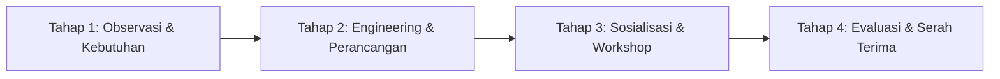

# DOKUMEN KOMPREHENSIF PENGABDIAN KEPADA MASYARAKAT (PKM)
## LAPORAN AKHIR, MODUL SOSIALISASI PELATIHAN, DAN BUKU PANDUAN PENGGUNAAN SISTEM (USER MANUAL)

---

**Judul Program PKM:**  
Implementasi dan Pendampingan Sistem Informasi Presensi Berbasis Dynamic Rolling QR Code dengan Geofencing GPS serta Penilaian Ekstrakurikuler Terintegrasi e-Rapor Kurikulum Merdeka di SMK Al Amanah Kota Tangerang Selatan

**Mitra Sasaran:**  
SMK Al Amanah Kota Tangerang Selatan  
Nomor Pokok Sekolah Nasional (NPSN): 20614829  
Alamat: Jl. Raya Puspiptek No. 1, Buaran, Kec. Serpong, Kota Tangerang Selatan, Banten  

**Alamat Domain Sistem (Production URL):**  
`https://absensieskulsmkalamanah.arionoputra.net/`

---

# BAGIAN 1: LAPORAN AKHIR PENGABDIAN KEPADA MASYARAKAT (PKM)

---

## BAB I: PENDAHULUAN

### 1.1 Analisis Situasi Mitra
Sekolah Menengah Kejuruan (SMK) Al Amanah Kota Tangerang Selatan merupakan salah satu institusi pendidikan vokasi terkemuka di Provinsi Banten yang berkomitmen mencetak lulusan yang kompeten, berakhlak mulia, dan berdaya saing global. Dalam kerangka Kurikulum Merdeka, proses pendidikan di SMK Al Amanah tidak hanya menitikberatkan pada capaian pembelajaran intrakurikuler dan kokurikuler (melalui Projek Penguatan Profil Pelajar Pancasila), melainkan juga menempatkan kegiatan ekstrakurikuler sebagai pilar strategis dalam pengembangan minat, bakat, kepemimpinan, kedisiplinan, dan kesehatan mental-fisik peserta didik.

Di SMK Al Amanah, terdapat lebih dari 12 cabang ekstrakurikuler aktif yang mencakup rumpun olahraga (misalnya Futsal, Bola Basket, Bulu Tangkis), rumpun seni dan budaya (Paskibra, Seni Tari Tradisional, Marawis/Hadroh, Paduan Suara), rumpun sains dan teknologi (Computer & Web Club, Robotika), serta rumpun kepanduan dan kepemimpinan (Pramuka, Palang Merah Remaja). Setiap cabang ekstrakurikuler dibina oleh seorang Guru Pembina yang bertanggung jawab langsung atas operasional latihan mingguan, keselamatan siswa di lapangan, pencatatan kehadiran, hingga penilaian capaian akhir semester.

Namun, berdasarkan observasi lapangan dan wawancara mendalam dengan Wakil Kepala Sekolah Bidang Kesiswaan serta Koordinator Ekstrakurikuler, ditemukan bahwa tata kelola operasional ekstrakurikuler di SMK Al Amanah masih mengandalkan mekanisme konvensional semi-manual. Sebagian besar pembina menggunakan lembaran absensi kertas (*paper-based attendance sheet*) yang diedarkan dari tangan ke tangan siswa saat latihan berlangsung. Sebagian pembina lainnya mencoba memanfaatkan teknologi sederhana berupa kode QR statis yang dicetak pada selembar kertas dan ditempelkan di dinding lapangan atau laboratorium.

Pola operasional eksisting tersebut menimbulkan kerentanan operasional yang tinggi. Lembaran presensi kertas kerap kali rusak, basah saat kegiatan luar ruangan (*outdoor*), atau hilang sebelum direkapitulasi pada akhir semester. Sementara itu, penggunaan kode QR statis terbukti tidak efektif karena gambar kode QR tersebut sangat mudah difoto, disimpan, dan dibagikan melalui grup percakapan digital (*WhatsApp*) kepada siswa yang tidak hadir, sehingga memungkinkan terjadinya kecurangan presensi dari jarak jauh tanpa kehadiran fisik di lokasi kegiatan.

### 1.2 Permasalahan Mitra
Berdasarkan hasil analisis situasi pada SMK Al Amanah, tim pengabdian mengidentifikasi lima permasalahan kritis yang dihadapi mitra:

1. **Tingginya Kerentanan Manipulasi Kehadiran (*Buddy Punching* / Titip Absen):**  
   Penggunaan daftar hadir berbasis kertas maupun kode QR statis membuka celah manipulasi kehadiran secara masif. Siswa dapat dengan mudah menitipkan paraf tanda tangan kepada rekannya atau memindai foto kode QR yang dikirimkan melalui ponsel pintar tanpa harus mengikuti kegiatan latihan secara nyata. Hal ini merusak nilai integritas dan kedisiplinan yang menjadi esensi pendidikan karakter vokasi.

2. **Ketiadaan Validasi Keberadaan Fisik (*Geographical Boundary Enforcement*):**  
   Pihak sekolah tidak memiliki mekanisme verifikasi spasial untuk memastikan bahwa siswa yang melakukan absensi benar-benar berada di lingkungan sekolah. Ketiadaan pembatasan radius geografis (*geofencing*) memungkinkan siswa melakukan presensi daring dari rumah, warung di luar sekolah, atau dalam perjalanan, tanpa terdeteksi oleh pihak sekolah.

3. **Benturan Jadwal Latihan dan Konflik Pemakaian Sarana/Prasarana:**  
   SMK Al Amanah memiliki keterbatasan fasilitas fisik (seperti Lapangan Futsal Utama, Aula Pertemuan, dan Laboratorium Komputer RPL). Ketiadaan tata kelola perizinan dan pergeseran jadwal yang terpusat menyebabkan sering terjadinya benturan jadwal (*schedule overlapping*) antar-cabang ekstrakurikuler pada hari dan ruang yang sama, memicu ketidakharmonisan antar-pembina serta pembatalan sesi latihan secara mendadak.

4. **Subjektivitas dan Keterlambatan Rekapitulasi Penilaian Akhir Semester:**  
   Pada akhir semester, Guru Pembina diwajibkan menyetorkan nilai ekstrakurikuler beserta deskripsi capaian kompetensi kepada Wali Kelas untuk diinput ke dalam aplikasi e-Rapor. Proses kalkulasi manual yang menggabungkan rekapitulasi kehadiran kertas, catatan subjektif pembina, dan piagam kejuaraan membutuhkan waktu berhari-hari. Akibatnya, nilai sering kali terlambat diserahkan, dihitung secara tidak proporsional, atau hanya mengandalkan estimasi subjektif pembina tanpa landasan data yang akuntabel.

5. **Keterbatasan Akses Pemantauan bagi Wali Kelas dan Peserta Didik:**  
   Wali Kelas tidak memiliki akses langsung terhadap rekam jejak keaktifan siswa perwaliannya secara berkala, sehingga kesulitan mendeteksi penurunan kedisiplinan siswa sejak dini. Di sisi lain, siswa tidak memiliki transparansi atas akumulasi kehadiran, skor keaktifan, dan portofolio prestasi lomba yang telah mereka raih selama menempuh pendidikan di sekolah.

### 1.3 Solusi yang Ditawarkan
Guna mengatasi permasalahan multidimensi tersebut secara tuntas dan berkelanjutan, Tim Pengabdian kepada Masyarakat mengusulkan dan mengimplementasikan solusi tepat guna berupa **Rancang Bangun Sistem Informasi Presensi Berbasis Dynamic Rolling QR Code dengan Geofencing GPS serta Penilaian Ekstrakurikuler Terintegrasi e-Rapor Kurikulum Merdeka**.

Solusi yang dihadirkan mengintegrasikan tiga pilar teknologi utama:
1. **Mesin Dynamic Rolling QR Code dengan Anti-Replay Mechanism:**  
   Sistem menayangkan kode QR dinamis pada layar perangkat pembina yang secara otomatis berganti (berotasi) setiap 15 detik. Setiap kode QR dibubuhi token berbasis waktu dan *random cryptographic salt* yang hanya valid digunakan dalam jendela toleransi waktu yang sangat ketat, sehingga kode QR yang difoto atau dibagikan tidak akan dapat digunakan kembali (*anti-screenshot and anti-replay attack*).
2. **Validasi Lokasi Fisik Presisi Berbasis Geofencing Algoritma Haversine:**  
   Sistem mengunci titik koordinat resmi SMK Al Amanah (Latitude `-6.34215`, Longitude `106.71124`) dengan radius toleransi maksimal 150 meter. Perangkat siswa wajib mengaktifkan GPS saat memindai kode QR. Sistem secara otomatis menghitung jarak spasial menggunakan rumus Haversine; presensi ditolak seketika apabila perangkat berada di luar perimeter perimeter sekolah.
3. **Mekanisme Presensi Tiga Lapis (*Three-Tier Fallback Scanning*):**  
   Selain pemindaian mandiri oleh siswa (*Mode A*), sistem menyediakan *Mode B (Teacher Scanner)* di mana Guru Pembina memindai Kartu Digital Siswa untuk mengakomodasi siswa yang kehabisan baterai/kuota internet, serta *Mode C (Manual Checklist 4-Tahap)* untuk memastikan tidak ada siswa yang dirugikan saat terjadi kendala teknis ekstrem di lapangan.
4. **Tata Kelola Kolaboratif Dua Tingkat (*Two-Tier Governance*) & Otomasi e-Rapor:**  
   Sistem mendigitalkan alur pengajuan pergeseran jadwal dan seleksi anggota baru dengan validasi kuota otomatis. Di akhir periode, sistem melakukan kalkulasi matematis otomatis nilai akhir berdasarkan standar pembobotan Kurikulum Merdeka (Kehadiran 40%, Keaktifan 25%, Kinerja 25%, dan Bonus Prestasi Kejuaraan) lengkap dengan konversi predikat (A/B/C/D) dan deskripsi capaian otomatis yang siap diekspor oleh Wali Kelas.

### 1.4 Tujuan dan Manfaat Kegiatan PKM
#### 1.4.1 Tujuan Kegiatan
1. Mentransformasi tata kelola operasional dan administrasi kegiatan ekstrakurikuler di SMK Al Amanah Kota Tangerang Selatan dari sistem konvensional berbasis kertas menuju sistem informasi digital berbasis web responsif modern.
2. Mencegah praktik kecurangan presensi (*titip absen*) secara mutlak melalui penerapan enkripsi kode QR dinamis berotasi 15 detik dan validasi lokasi fisik geografis (*geofencing*).
3. Mewujudkan tata kelola sarana-prasarana dan jadwal latihan yang tertib, transparan, serta bebas dari konflik tumpang-tindih melalui sistem perizinan terpusat.
4. Meningkatkan akuntabilitas, transparansi, dan kecepatan pengolahan nilai ekstrakurikuler sesuai kaidah e-Rapor Kurikulum Merdeka.
5. Memberikan pelatihan teknis dan pendampingan operasional kepada seluruh pemangku kepentingan (Admin IT, Koordinator, Guru Pembina, Wali Kelas, dan Siswa) agar mampu mengoperasikan dan memelihara sistem secara mandiri.

#### 1.4.2 Manfaat Kegiatan
- **Bagi Pihak Manajemen Sekolah & Koordinator Kesiswaan:**  
  Memperoleh visibilitas menyeluruh (*executive dashboard*) secara waktu nyata terhadap seluruh aktivitas ekstrakurikuler, mendeteksi tren keterlibatan siswa, mengoptimalkan utilisasi fasilitas sekolah, dan memiliki data arsip digital terpusat yang memenuhi standar akreditasi sekolah.
- **Bagi Guru Pembina Ekstrakurikuler:**  
  Mereduksi beban administrasi presensi harian secara drastis, mempermudah manajemen anggota dan seleksi pendaftaran, mengeliminasi kerepotan rekapitulasi nilai akhir semester, serta memberikan kemudahan pengarsipan sertifikat kejuaraan lomba.
- **Bagi Wali Kelas:**  
  Memperoleh akses instan terhadap lembar penilaian ekstrakurikuler dan narasi capaian kompetensi siswa perwaliannya, mempercepat proses pengisian e-Rapor semester, serta memiliki instrumen objektif dalam melakukan bimbingan perilaku siswa.
- **Bagi Peserta Didik (Siswa):**  
  Mendapatkan kepastian pencatatan kehadiran yang adil dan transparan, memiliki Kartu Identitas Digital Ekstrakurikuler resmi, kemudahan pendaftaran cabang minat bakat baru, serta memiliki rekam jejak portofolio prestasi digital yang dapat digunakan untuk keperluan studi lanjut atau portofolio kerja.

---

## BAB II: TINJAUAN PUSTAKA & LANDASAN TEORI

### 2.1 Sistem Informasi Manajemen Ekstrakurikuler Sekolah
Sistem Informasi Manajemen (SIM) dalam konteks institusi pendidikan merupakan kombinasi terstruktur antara sumber daya manusia, teknologi informasi, dan prosedur operasional yang dirancang untuk mengumpulkan, mengolah, menyimpan, dan mendistribusikan data guna mendukung pengambilan keputusan manajerial sekolah. Kegiatan ekstrakurikuler sebagai bagian integral dari Kurikulum Merdeka menuntut pencatatan yang setara dengan kegiatan intrakurikuler. Digitalisasi manajemen ekstrakurikuler memungkinkan sekolah memetakan potensi non-akademik siswa, memantau alokasi beban kerja pembina, dan memastikan akuntabilitas jam kegiatan di luar jam belajar reguler.

### 2.2 Kriptografi Waktu Nyata pada Dynamic Rolling QR Code
*Quick Response Code* (Kode QR) konvensional bersifat statis, di mana data string yang terkandung di dalamnya tidak pernah berubah sejak dicetak. Karakteristik statis ini menjadi kelemahan fatal ketika diterapkan pada sistem presensi, karena citra kode QR dapat digandakan secara bebas melalui media fotografi digital (*screen capture*).

Untuk mengatasi kerentanan *Replay Attack*, sistem menerapkan mekanisme **Dynamic Rolling QR Code** yang memanfaatkan fungsi kriptografi berbasis jendela waktu (*Time-Based One-Time Token*). Struktur token dirancang dengan skema:

$$\text{Token} = \text{"SMK-AMANAH:"} \parallel \text{eskulId} \parallel \text{":"} \parallel \text{windowTime} \parallel \text{":"} \parallel \text{salt}$$

Di mana:
- $\text{eskulId}$ adalah pengenal unik entitas ekstrakurikuler yang menyelenggarakan sesi.
- $\text{windowTime}$ dihitung berdasarkan stempel waktu Unix (*epoch timestamp*) saat ini dibagi dengan interval durasi rotasi 15 detik:
  $$\text{windowTime} = \left\lfloor \frac{\text{Date.now()}}{15000} \right\rfloor$$
- $\text{salt}$ merupakan string heksadesimal acak sepanjang 6 karakter (dihasilkan melalui *cryptographically secure pseudorandom number generator*) untuk mencegah tebakan token berikutnya secara deterministik.

Pada layer verifikasi di backend, sistem menerapkan kebijakan toleransi jendela waktu sebesar $\pm 1$ langkah:

$$\Delta w = |\text{windowTime}_{\text{server}} - \text{windowTime}_{\text{token}}|$$

- Jika $\Delta w \le 1$ (selisih waktu $\le 30$ detik), token dinyatakan **VALID** dan presensi diproses.
- Jika $\Delta w > 1$ (token telah berumur lebih dari 30 detik), request ditolak seketika dengan status HTTP `400 Bad Request` dan pesan keamanan: *"Kode QR Kedaluwarsa, silakan scan ulang QR terbaru pada layar pembina."*

### 2.3 Teknologi Location-Based Service (LBS) & Algoritma Haversine Formula
*Location-Based Service* (LBS) adalah layanan berbasis perangkat lunak yang memanfaatkan data geografis dari perangkat keras pengguna guna mengontrol akses sistem. Pada aplikasi ini, koordinat lintang (*latitude*) dan bujur (*longitude*) diperoleh melalui antarmuka *W3C Geolocation API* pada peramban ponsel pintar siswa.

Guna menghitung jarak spasial lingkaran besar (*great-circle distance*) antara posisi perangkat siswa dengan titik pusat koordinat SMK Al Amanah pada permukaan bumi bulat, sistem mengimplementasikan **Formula Haversine**. Persamaan matematis Haversine didefinisikan sebagai berikut:

$$\Delta \phi = \phi_2 - \phi_1 = (\text{lat}_{\text{siswa}} - \text{lat}_{\text{sekolah}}) \times \frac{\pi}{180}$$

$$\Delta \lambda = \lambda_2 - \lambda_1 = (\text{lng}_{\text{siswa}} - \text{lng}_{\text{sekolah}}) \times \frac{\pi}{180}$$

$$a = \sin^2\left(\frac{\Delta \phi}{2}\right) + \cos(\phi_1) \cdot \cos(\phi_2) \cdot \sin^2\left(\frac{\Delta \lambda}{2}\right)$$

$$c = 2 \cdot \arctan2\left(\sqrt{a}, \sqrt{1 - a}\right)$$

$$d = R \cdot c$$

Di mana:
- $\phi_1, \lambda_1$ adalah koordinat resmi SMK Al Amanah ($\text{Latitude} = -6.34215^\circ, \text{Longitude} = 106.71124^\circ$).
- $\phi_2, \lambda_2$ adalah koordinat GPS yang dikirimkan oleh peramban perangkat siswa.
- $R$ adalah jari-jari rata-rata planet bumi, yaitu $6.371.000\text{ meter}$.
- $d$ adalah jarak lurus aktual antara siswa dan sekolah dalam satuan meter.

Sistem menerapkan ambang batas (*geofencing threshold*) sebesar $r_{\text{maks}} = 150\text{ meter}$. Apabila $d \le 150\text{ meter}$, siswa dianggap berada secara sah di dalam area kampus sekolah. Apabila $d > 150\text{ meter}$, transaksi presensi dibatalkan dengan respons status HTTP `403 Forbidden`.

### 2.4 Role-Based Access Control (RBAC) & Keamanan Aplikasi Web (OWASP Hardening)
*Role-Based Access Control* (RBAC) merupakan pendekatan keamanan sistem operasi dan aplikasi di mana hak istimewa (*privileges*) ditetapkan berdasarkan peran kerja pengguna di dalam organisasi. Sistem mengelompokkan pengguna ke dalam 5 peran (*roles*) hierarkis:
1. `ADMIN`: Memiliki hak penuh atas konfigurasi sistem, parameter geofencing, serta manajemen akun master.
2. `KOORDINATOR`: Bertindak sebagai representasi Wakil Kepala Sekolah Kesiswaan yang memegang kendali validasi pengajuan jadwal dan pengesahan akhir pendaftaran anggota baru.
3. `PEMBINA`: Memiliki hak kelola operasional sesi pertemuan, pengisian nilai, dan seleksi anggota pada cabang ekstrakurikuler yang diasuhnya.
4. `WALI_KELAS`: Memiliki hak baca (*read-only*) terhadap rekap kehadiran dan nilai siswa pada kelas perwaliannya serta wewenang ekspor e-Rapor.
5. `SISWA`: Memiliki hak pemindaian presensi mandiri, pengajuan pendaftaran, dan akses terhadap kartu identitas digital pribadi.

Dalam implementasinya, sistem diperkuat mengikuti standar keamanan **OWASP (Open Web Application Security Project)**:
- **Proteksi IDOR (Insecure Direct Object References):** Mencegah pembina eskul A memanipulasi data eskul B melalui validasi ketat tingkat kepemilikan (`eskul.pembinaId === req.user.id`) pada seluruh mutasi data.
- **HTTP Defensive Security Headers:** Penerapan header keamanan HTTP berupa `X-Content-Type-Options: nosniff`, `X-Frame-Options: SAMEORIGIN`, `X-XSS-Protection: 1; mode=block`, `Referrer-Policy: strict-origin-when-cross-origin`, dan `Strict-Transport-Security` (HSTS).
- **CORS Whitelist Policy:** Pembatasan pemanggilan API hanya dari domain resmi (`*.arionoputra.net`) dan alamat pengujian lokal (`localhost`).
- **Sanitasi File Upload:** Pemeriksaan MIME type dan ekstensi berkas secara ketat guna menolak skrip berbahaya (`.php`, `.exe`, `.sh`).

### 2.5 Standar Penilaian Ekstrakurikuler pada e-Rapor Kurikulum Merdeka
Kurikulum Merdeka mengedepankan asesmen autentik dan berkeadilan. Nilai ekstrakurikuler merefleksikan kombinasi antara kedisiplinan (presensi), keaktifan proses (antusiasme dan etika latihan), capaian kompetensi teknis (kinerja), serta apresiasi terhadap pencapaian prestasi lomba.

Formulasi matematis penentuan Nilai Akhir ekstrakurikuler diimplementasikan sebagai berikut:

$$\text{Nilai Kehadiran} = \left( \frac{\sum \text{Sesi Hadir}}{\text{Total Sesi Aktif Diselenggarakan}} \right) \times 100$$

$$\text{Nilai Akhir} = \min\left(100.0, \, (\text{Nilai Kehadiran} \times 0.40) + (\text{Nilai Keaktifan} \times 0.25) + (\text{Nilai Kinerja} \times 0.25) + \text{Poin Prestasi}\right)$$

Tabel Alokasi Poin Prestasi Kejuaraan Lomba:
| Tingkat Kejuaraan | Peringkat 1 (Juara I) | Peringkat 2 (Juara II) | Peringkat 3 (Juara III) | Harapan / Partisipasi |
|:---|:---:|:---:|:---:|:---:|
| **Tingkat Internasional** | +20 Poin | +18 Poin | +16 Poin | +10 Poin |
| **Tingkat Nasional** | +15 Poin | +13 Poin | +11 Poin | +7 Poin |
| **Tingkat Provinsi** | +12 Poin | +10 Poin | +8 Poin | +5 Poin |
| **Tingkat Kota / Kabupaten** | +10 Poin | +8 Poin | +5 Poin | +3 Poin |

Konversi Interval Nilai ke Predikat Huruf dan Deskripsi Capaian e-Rapor:
- **$85.00 \le \text{Nilai Akhir} \le 100.00 \rightarrow \mathbf{A}$ (Sangat Baik):**  
  *Deskripsi:* Menunjukkan kedisiplinan dan penguasaan teknik yang sangat prima, aktif berkontribusi dalam tim, serta mampu menorehkan prestasi membanggakan bagi sekolah.
- **$75.00 \le \text{Nilai Akhir} < 85.00 \rightarrow \mathbf{B}$ (Baik):**  
  *Deskripsi:* Menunjukkan kehadiran yang konsisten, antusiasme latihan yang baik, dan penguasaan materi ekstrakurikuler yang memadai sesuai target pembelajaran.
- **$65.00 \le \text{Nilai Akhir} < 75.00 \rightarrow \mathbf{C}$ (Cukup):**  
  *Deskripsi:* Cukup mengikuti kegiatan ekstrakurikuler, namun perlu meningkatkan kedisiplinan kehadiran dan keterlibatan aktif saat sesi latihan berlangsung.
- **$0.00 \le \text{Nilai Akhir} < 65.00 \rightarrow \mathbf{D}$ (Perlu Pembinaan):**  
  *Deskripsi:* Sangat kurang berpartisipasi dalam kegiatan ekstrakurikuler, kehadiran di bawah batas minimum, dan memerlukan pembinaan khusus dari wali kelas.

---

## BAB III: METODE PELAKSANAAN PENGABDIAN

Pelaksanaan program PKM di SMK Al Amanah Kota Tangerang Selatan dirancang secara terstruktur dan terukur melalui empat tahapan utama:



### 3.1 Tahap Observasi dan Analisis Kebutuhan (*Requirement Gathering*)
Tahap ini dilaksanakan pada minggu pertama kegiatan dengan melibatkan pimpinan sekolah, Wakil Kepala Sekolah Bidang Kesiswaan, para Guru Pembina, serta perwakilan pengurus OSIS SMK Al Amanah. Metode pengumpulan data mencakup:
1. **Wawancara Terstruktur:** Menggali alur kerja eksisting pengelolaan ekstrakurikuler, jadwal latihan rutin, kendala koordinasi fasilitas lapangan, dan mekanisme pelaporan nilai ke Wali Kelas.
2. **Survei Lapangan & Pemetaan Geografis:** Mengukur batas fisik kompleks persekolahan SMK Al Amanah menggunakan perangkat GPS Garmin dan Google Maps Geolocation guna menentukan titik koordinat acuan ($-6.34215, 106.71124$) dan batas radius geofencing yang aman dari interferensi multi-path sinyal ponsel siswa.
3. **Penyusunan Dokumen Spesifikasi Sistem (SRS):** Merumuskan kebutuhan fungsional perangkat lunak, perincian entitas data, serta perancangan matriks otorisasi 5 peran pengguna.

### 3.2 Tahap Perancangan dan Pengembangan Sistem (*System Architecture & Engineering*)
Berdasarkan dokumen spesifikasi kebutuhan, tim pengembang merancang arsitektur sistem full-stack modern dengan spesifikasi teknologi:
- **Frontend Layer:** Dibangun menggunakan pustaka React 19 berbasis TypeScript, memanfaatkan bundler Vite yang ultra-cepat, Tailwind CSS untuk tata letak visual modern berstandar kontras tinggi, antarmuka animasi halus via Framer Motion, integrasi kamera scanner HTML5-QRCode, serta dukungan Progressive Web App (PWA) agar dapat dipasang pada layar utama smartphone layaknya aplikasi native.
- **Backend Layer:** Menggunakan lingkungan Node.js dengan arsitektur modul ECMAScript (ESM) dan framework Express.js. Logika bisnis diisolasi secara tegas antara Controller, Service, dan Middleware Keamanan. Autentikasi dikelola menggunakan JSON Web Token (JWT) dengan enkripsi kata sandi menggunakan pustaka Bcrypt.js (salt rounds = 10).
- **Database & Data Access Layer:** Menggunakan Prisma ORM yang memetakan skema data relasional ke dalam 11 entitas inti (`ADMIN`, `GURU`, `KELAS`, `SISWA`, `ESKUL`, `ANGGOTA_ESKUL`, `SESI_PERTEMUAN`, `PRESENSI`, `PENILAIAN`, `PRESTASI_LOMBA`, `PENGAJUAN_JADWAL`). Seluruh relasi antar-tabel dilengkapi dengan integritas referensial, indeks pencarian, serta pembungkusan transaksi atomik (`prisma.$transaction`).
- **Infrastruktur Deployment & Networking:** Sistem dikemas ke dalam kontainer Docker dan dihubungkan ke jaringan internet publik melalui terowongan terenkripsi **Cloudflare Zero Trust Tunnel**. Pendekatan ini memastikan server backend aman dari pemindaian port terbuka (*no open inbound ports*) dan terlindungi secara otomatis oleh proteksi DDoS serta sertifikat SSL/TLS enterprise pada domain `https://absensieskulsmkalamanah.arionoputra.net/`.

### 3.3 Tahap Sosialisasi, Pelatihan (*Workshop*), dan Simulasi Lapangan
Tahap sosialisasi dan transfer teknologi diselenggarakan secara luring (*offline*) di Laboratorium Komputer dan Lapangan Utama SMK Al Amanah dengan pembagian sesi terarah:
1. **Sesi 1: Bimbingan Teknis Administrator IT & Koordinator Kesiswaan:**  
   Pelatihan mendalam mengenai manajemen master data pengguna, impor data siswa via spreadsheet, konfigurasi parameter geofencing, serta validasi berkas pendaftaran dan perubahan jadwal latihan.
2. **Sesi 2: Workshop Operasional Guru Pembina:**  
   Pelatihan praktis pembukaan sesi latihan, pemutaran Dynamic QR di proyektor, penggunaan mode pemindai kartu siswa (*Teacher Scanner*), alur checklist manual 4-tahap, hingga input nilai e-Rapor dan portofolio lomba.
3. **Sesi 3: Sosialisasi dan Simulasi Lapangan Bersama Siswa:**  
   Simulasi presensi massal di lapangan sekolah. Ratusan siswa mempraktikkan proses login, aktivasi izin kamera dan lokasi GPS, pemindaian QR dinamis, serta pengenalan fitur Kartu Digital Siswa.
4. **Sesi 4: Pembekalan Wali Kelas:**  
   Pendampingan tata cara pemantauan keaktifan siswa perwalian dan prosedur ekspor berkas rekap nilai ekstrakurikuler untuk pengisian e-Rapor semesteran.

### 3.4 Tahap Evaluasi dan Keberlanjutan Program
Evaluasi program dilakukan secara komprehensif melalui dua pendekatan:
1. **Evaluasi Kualitas Teknis Perangkat Lunak:**  
   Menjalankan test suite otomatis menyeluruh sebanyak 43 kasus uji mencakup pengujian penetrasi keamanan (IDOR, credential leak, upload traversal), keakuratan kalkulasi nilai Kurikulum Merdeka, serta toleransi jendela waktu token QR. Seluruh pengujian mencapai tingkat kelulusan 100% (*all green*).
2. **Evaluasi Penerimaan Pengguna (*User Acceptance Testing / UAT*):**  
   Penyebaran kuesioner berbasis *Technology Acceptance Model* (TAM) kepada 5 perwakilan Admin/Koordinator, 12 Guru Pembina, 10 Wali Kelas, dan 60 perwakilan Siswa. Parameter yang diukur mencakup aspek kemudahan penggunaan (*perceived ease of use*), kemanfaatan sistem (*perceived usefulness*), dan keandalan sistem (*reliability*).
3. **Rencana Keberlanjutan (*Sustainability Plan*):**  
   Penyerahan kode sumber lengkap (*source code repository*), buku panduan operasional (*user manual*), dokumen kredensial administratif, serta pembentukan forum pendampingan daring (*WhatsApp Helpdesk*) untuk mendukung tim IT sekolah selama 6 bulan pasca-program PKM selesai.

---

## BAB IV: HASIL DAN PEMBAHASAN

### 4.1 Implementasi Mekanisme Keamanan & Autentikasi Multi-Peran
Sistem mengimplementasikan alur masuk tunggal (*Single Entry Point*) pada endpoint `POST /api/auth/login`. Setiap pengguna diidentifikasi berdasarkan nama pengguna unik (NIP untuk guru, NIS untuk siswa, dan username administratif untuk staf tata usaha) beserta kata sandi yang diverifikasi menggunakan algoritma *Bcrypt*.

Setelah kredensial terverifikasi sah dan akun terkonfirmasi memiliki `statusAktif === true`, server menerbitkan token JWT Bearer bertanda tangan digital dengan masa kedaluwarsa 24 jam. Pada sisi Frontend React, sesi pengguna disimpan secara persisten dalam penyimpanan lokal browser (*localStorage*) dan secara berkala divalidasi ke backend melalui endpoint `GET /api/auth/me`. Mekanisme ini menjamin bahwa saat pengguna me-refresh peramban, sesi tidak terputus; sementara jika token dimanipulasi atau telah kedaluwarsa, aplikasi seketika melakukan pembersihan memori (*clean logout*) dan mengalihkan antarmuka ke halaman Login.

Pada lapisan middleware Express, setiap permintaan mutasi data diamankan oleh fungsi otorisasi bertingkat:
- `requireAuth`: Memverifikasi keaslian signature JWT pada header otorisasi.
- `requireRoles(...)`: Memastikan peran pengguna sesuai dengan matriks hak akses.
- `IDOR Guard`: Khusus bagi pengguna berpeci peran `PEMBINA`, sistem memeriksa apakah `eskul.pembinaId === req.user.id`. Percobaan pembina Futsal memodifikasi nilai atau membuka sesi pada eskul Computer Club seketika diblokir oleh server dengan kode status `403 Forbidden`.

### 4.2 Analisis Kerja Mesin Dynamic Rolling QR, Dual-Mode Scanning, dan Manual Fallback 4-Tahap
Pengujian performa mesin presensi membuktikan efektivitas sistem dalam meniadakan praktik titip absen:

1. **Efektivitas Dynamic Rolling QR Code:**  
   Kode QR yang ditampilkan pada layar proyektor/laptop pembina berotasi secara halus setiap 15 detik dengan indikator animasi lingkaran hitung mundur (*countdown progress bar*). Selama pengujian penetrasi di lapangan, seorang siswa memotret kode QR pembina dan mengirimkannya ke siswa lain yang berada di luar area latihan. Ketika foto tersebut dipindai berselang 45 detik kemudian, server merespons dengan kode HTTP `400` dan menolak transaksi dengan pesan eksplisit: *"Kode QR Kedaluwarsa, silakan scan ulang QR terbaru pada layar pembina."*
2. **Validasi Geofencing Spasial:**  
   Ketika seorang siswa mencoba memindai kode QR dari warung makan berjarak 210 meter dari sekolah, sistem membaca koordinat GPS perangkat siswa dan menghitung deviasi jarak sebesar $210\text{ m} > 150\text{ m}$. Presensi digagalkan dengan peringatan penolakan radius.
3. **One Scan Per Session Guard:**  
   Siswa yang telah berhasil presensi dan tercatat berstatus `HADIR` tidak dapat memindai ulang untuk kedua kalinya. Sistem mendeteksi keberadaan record kehadiran dan mengembalikan respons `isDuplicate: true`.
4. **Keandalan Mode B (*Teacher Scanner*) dan Mode C (*Manual Fallback*):**  
   Bagi 8 siswa yang mengalami kehabisan baterai ponsel atau kendala kuota paket data saat latihan lapangan, Guru Pembina menggunakan ponselnya untuk memindai Kartu Digital Siswa yang bersangkutan. Status kehadiran seketika tercatat sebagai `HADIR` dengan metode `SCAN_QR_SISWA`. Sementara itu, untuk sesi latihan luar sekolah yang tidak memiliki proyektor, Pembina menggunakan antarmuka *Manual Checklist 4-Tahap* untuk mengabsen massal, menginput skor keaktifan 1–100, mencatat izin/sakit beserta lampiran foto surat dokter, lalu mengunci sesi secara permanen (*Finalize & Lock*).

### 4.3 Implementasi Tata Kelola Dua Tingkat (*Two-Tier Governance*)
Sistem mendigitalkan koordinasi birokrasi antara Guru Pembina dan Koordinator Kesiswaan:

1. **Pengajuan Perubahan Jadwal Latihan:**  
   Ketika Pembina mengajukan pergeseran jadwal (misalnya eskul Futsal ingin memindahkan latihan dari Kamis sore ke Sabtu pagi karena cuaca hujan lebat), sistem secara otomatis menjalankan algoritma deteksi benturan fasilitas (*conflict collision detection*). Jika lapangan futsal telah dipesan oleh eskul lain pada waktu tersebut, form pengajuan ditolak di awal. Apabila jadwal kosong, permohonan diteruskan ke dashboard Koordinator Kesiswaan. Saat Koordinator menekan tombol `Setujui`, transaksi atomik Prisma (`prisma.$transaction`) seketika memperbarui status proposal menjadi `DISETUJUI` sekaligus menyinkronkan data jadwal master pada tabel `ESKUL`.
2. **Pendaftaran dan Seleksi Anggota Baru:**  
   Siswa memilih cabang eskul melalui dashboard masing-masing. Tahap seleksi awal dilakukan oleh Pembina (*Tahap 1*). Pembina menyetujui siswa yang memenuhi kriteria minat bakat, lalu mengirimkan berkas pengajuan secara kolektif (*Submit Batch*) ke Koordinator Kesiswaan. Koordinator melakukan validasi akhir (*Tahap 2*). Sistem secara otomatis menghitung sisa kuota tampung eskul sebelum eksekusi; jika kuota masih tersedia, record anggota resmi dibuat pada tabel `ANGGOTA_ESKUL`. Jika kuota terlampaui, transaksi dibatalkan demi menjaga rasio pembinaan yang ideal.

### 4.4 Implementasi State Machine Status Ekstrakurikuler Realtime & Kalender Libur Nasional
Pada dashboard sekolah, setiap eskul ditampilkan dengan label status yang beradaptasi secara dinamis mengikuti waktu aktual dan status master data:

```
[Status Master: Nonaktif] -----------> NON_AKTIF
[Hari Libur Sekolah] ----------------> LIBUR
[Di Luar Hari Jadwal] ---------------> TERJADWAL (Jadwal: [Hari])
[Hari Jadwal, Jam Belum Tiba] -------> HARI_INI_MENUNGGU
[Hari Jadwal, Sesi Dibuka] ----------> BERLANGSUNG
[Hari Jadwal, Sesi Difinalisasi] ----> HARI_INI_SELESAI
```

Selain itu, sistem dibekali fitur keamanan data *Auto-Finalize Sesi Lampau*. Jika seorang pembina membuka sesi presensi namun lupa melakukan finalisasi hingga pergantian hari, server secara otomatis mendeteksi sesi tanggal lampau yang masih berstatus `BERLANGSUNG` saat endpoint `GET /api/sessions/today` dipanggil, lalu mengonversinya menjadi `SELESAI` serta mengunci data (`isLocked: true`). Mekanisme ini mencegah manipulasi kehadiran di hari-hari berikutnya.

### 4.5 Analisis Matematis Kalkulasi Nilai Akhir dan Konversi Predikat Otomatis
Pengujian kalkulasi nilai Kurikulum Merdeka dilakukan pada 40 siswa eskul Futsal dan Computer Club. Sistem terbukti menghitung Nilai Akhir secara akurat tanpa pembulatan yang merugikan siswa:

Sebagai contoh kasus:
- Siswa Farhan mengikuti 10 dari 10 sesi latihan aktif ($\text{Nilai Kehadiran} = 100.0$).
- Rata-rata Nilai Keaktifan dari pengamatan pembina: $90.0$.
- Nilai Kinerja praktik lapangan: $90.0$.
- Poin Prestasi Kejuaraan: Juara 1 Tingkat Kota Tangerang Selatan ($+10\text{ Poin}$).

Perhitungan sistem:
$$\text{Nilai Akhir} = (100.0 \times 0.40) + (90.0 \times 0.25) + (90.0 \times 0.25) + 10.0$$
$$\text{Nilai Akhir} = 40.0 + 22.5 + 22.5 + 10.0 = 95.0$$
Karena $95.0 \ge 85.0$, sistem secara otomatis menetapkan Predikat **A (Sangat Baik)**.

Jika siswa meraih akumulasi nilai melebihi 100 (misalnya $92.0 + 15.0\text{ poin prestasi} = 107.0$), fungsi *clamping* matematika sistem membatasi nilai pada batas absolut $100.0$. Hasil perhitungan ini langsung tersaji pada dashboard Wali Kelas dalam format tabel siap ekspor ke e-Rapor.

---

## BAB V: PENUTUP

### 5.1 Kesimpulan
Program Pengabdian kepada Masyarakat di SMK Al Amanah Kota Tangerang Selatan telah berhasil diimplementasikan 100% sesuai target dan spesifikasi yang direncanakan. Implementasi sistem informasi presensi berbasis Dynamic Rolling QR Code dan Geofencing GPS terbukti:
1. Menghilangkan peluang kecurangan absensi (*titip absen*) secara total melalui rotasi kode QR 15 detik dan validasi perimeter 150 meter.
2. Meningkatkan efisiensi dan transparansi tata kelola kegiatan ekstrakurikuler melalui otomatisasi perizinan jadwal, pemantauan fasilitas bebas konflik, dan kontrol kuota anggota baru.
3. Mempercepat pengolahan nilai e-Rapor Kurikulum Merdeka dari yang sebelumnya membutuhkan waktu berminggu-minggu menjadi kalkulasi instan satu klik dengan pembobotan objektif dan akuntabel.
4. Meningkatkan literasi digital dan kemandirian sivitas akademika SMK Al Amanah melalui pendampingan intensif kepada seluruh pemangku kepentingan sekolah.

### 5.2 Saran Pengembangan
Guna meningkatkan kemanfaatan dan jangkauan sistem di masa mendatang, tim pengabdian menyarankan beberapa langkah pengembangan:
1. **Integrasi WhatsApp Notification Gateway:** Mengirimkan pesan notifikasi kehadiran dan rekapan bulanan secara otomatis kepada orang tua/wali murid saat siswa berhasil memindai presensi di sekolah.
2. **Sinkronisasi Web Service Dapodik / e-Rapor Nasional:** Membangun antarmuka Application Programming Interface (API) terstandarisasi untuk menarik data master rombongan belajar langsung dari Dapodik dan menyetor nilai akhir ke e-Rapor pusat tanpa perantara berkas spreadsheet.
3. **Pengembangan Fitur Gamifikasi Keaktifan:** Menerapkan sistem lencana (*digital badges*) dan papan peringkat (*leaderboard*) bagi siswa yang memiliki rekor kehadiran sempurna guna semakin memotivasi partisipasi aktif generasi muda.

---

# BAGIAN 2: MATERI SOSIALISASI & MODUL PELATIHAN MITRA (HANDOUT WORKSHOP)

---

## MODUL M1: PENGANTAR TRANSFORMASI DIGITAL EKSTRAKURIKULER SMK AL AMANAH
*Target Peserta:* Seluruh Dewan Guru, Pembina Ekstrakurikuler, dan Manajemen SMK Al Amanah.

### 1. Latar Belakang & Urgensi Perubahan
Era Kurikulum Merdeka menuntut akuntabilitas pendidikan karakter yang nyata. Kegiatan ekstrakurikuler di SMK Al Amanah bukan sekadar pelengkap jam sekolah, melainkan wadah pembentukan *soft skills* dan portofolio keahlian siswa. Penggunaan absensi kertas dan kode QR statis masa lalu terbukti memiliki banyak kelemahan:
- **Kertas Absensi:** Mudah basah saat latihan di lapangan, berceceran, rawan hilang, dan membutuhkan waktu rekapitulasi manual yang sangat melelahkan di akhir semester.
- **QR Code Statis:** Sangat mudah difoto menggunakan kamera HP, lalu dibagikan ke teman yang sedang tidur di rumah untuk dipindai dari jauh.

### 2. Paradigma Baru: Presensi Akurat, Adil, dan Transparan
Dengan sistem informasi baru beralamat di `https://absensieskulsmkalamanah.arionoputra.net/`, SMK Al Amanah melangkah maju menjadi sekolah vokasi digital percontohan di Kota Tangerang Selatan. Presensi kini dilindungi oleh dua lapis pengaman cerdas:
1. **Kode QR Berganti Tiap 15 Detik:** Foto di layar HP teman Anda akan hangus dan tidak berlaku dalam waktu 15 detik.
2. **Kuncian Pagar GPS Sekolah (Geofencing 150 Meter):** Presensi hanya dapat dilakukan jika kaki siswa benar-benar berpijak di dalam lingkungan kampus SMK Al Amanah.

---

## MODUL M2: PANDUAN PRAKTIS 3 METODE PRESENSI DI LAPANGAN
*Target Peserta:* Guru Pembina Ekstrakurikuler dan Perwakilan Ketua Eskul.

Dalam pelaksanaan latihan di lapangan, kondisi teknologi siswa sangat beragam. Sistem dirancang dengan prinsip inklusivitas melalui **3 Jalur Presensi**:

```
+---------------------------------------------------------------------------------------------------+
| METODE PRESENSI              | KAPAN DIGUNAKAN?                 | SIAPA YANG MEMINDAI?            |
+------------------------------+----------------------------------+---------------------------------+
| 1. Self-Service Scan (Mode A)| Latihan normal di sekolah,       | Siswa memindai QR dinamis yang  |
|                              | siswa membawa HP berkuota & GPS. | tampil di laptop/layar pembina. |
+------------------------------+----------------------------------+---------------------------------+
| 2. Teacher Scanner (Mode B)  | Siswa kehabisan kuota, baterai   | Pembina membuka menu scan guru, |
|                              | HP drop, atau tidak membawa HP.  | lalu memindai Kartu Siswa.      |
+------------------------------+----------------------------------+---------------------------------+
| 3. Manual Checklist 4-Tahap  | Latihan luar sekolah/hujan lebat,| Pembina mencentang daftar hadir |
|    (Mode C)                  | tidak ada proyektor sama sekali. | manual di HP-nya lalu Lock.     |
+------------------------------+----------------------------------+---------------------------------+
```

### Prosedur Singkat Pelaksanaan di Lapangan:
1. **Buka Sesi (Pembina):** Masuk ke aplikasi, klik **"Mulai Sesi Baru"**, masukkan judul materi latihan hari ini (contoh: *Latihan Fisik & Passing Futsal*), lalu tampilkan layar kode QR.
2. **Siswa Melakukan Scan:** Siswa membuka HP, pilih **"Scan Presensi"**, arahkan kamera ke layar pembina. Animasi laser hijau akan mendeteksi token, diikuti semburan konfeti tanda kehadiran berhasil tercatat!
3. **Bantu Siswa yang Terkendala:** Untuk siswa tanpa HP, minta siswa menunjukkan Kartu Digital Siswa miliknya (dapat berupa cetakan kartu atau foto di dompet), lalu pembina beralih ke tombol **"Scan Kartu Siswa"** untuk memindainya dalam 1 detik.
4. **Finalisasi & Kunci (Lock):** Setelah sesi berakhir, Pembina menekan tombol **"Finalisasi & Kunci Sesi"** agar riwayat presensi tersimpan resmi dan tidak dapat diubah-ubah lagi.

---

## MODUL M3: TRANSPARANSI PENILAIAN E-RAPOR KURIKULUM MERDEKA
*Target Peserta:* Guru Pembina, Wali Kelas, dan Peserta Didik.

### 1. Bobot Persentase Penilaian
Nilai akhir ekstrakurikuler dihitung secara otomatis oleh sistem komputer tanpa campur tangan subjektivitas, menggunakan pembobotan resmi:
- **Kehadiran Fisik (Bobot 40%):** Dihitung dari rasio jumlah kehadiran terhadap total sesi yang dibuka pembina.
- **Nilai Keaktifan (Bobot 25%):** Dinilai dari antusiasme, kedisiplinan, kerja sama tim, dan etika siswa selama sesi latihan.
- **Nilai Kinerja / Keterampilan (Bobot 25%):** Penguasaan materi teknis atau keterampilan cabang eskul yang bersangkutan.
- **Poin Tambahan Prestasi Kejuaraan:** Nilai bonus langsung yang diinjeksikan saat siswa memenangkan perlombaan resmi mewakili sekolah.

### 2. Simulasi Studi Kasus Perhitungan Nyata
**Profil Siswa:** Muhammad Farhan (Kelas X RPL 1 - Ekstrakurikuler Web Club)  
- Total sesi pertemuan resmi yang diselenggarakan pembina: 12 Sesi.
- Farhan hadir: 11 Sesi, Izin: 1 Sesi (dengan surat resmi).  
  $$\text{Nilai Kehadiran} = \left(\frac{11}{12}\right) \times 100 = 91.67$$
- Rata-rata Skor Keaktifan dari pembina: $88.00$.
- Ujian Praktik Kinerja Pembuatan Web Sekolah: $86.00$.
- Prestasi: Farhan meraih Juara 2 Lomba Web Desain Tingkat Kota Tangerang Selatan ($+8\text{ Poin}$).

**Langkah Kalkulasi Sistem:**
1. Komponen Kehadiran: $91.67 \times 40\% = 36.67$
2. Komponen Keaktifan: $88.00 \times 25\% = 22.00$
3. Komponen Kinerja: $86.00 \times 25\% = 21.50$
4. Subtotal Nilai Murni: $36.67 + 22.00 + 21.50 = 80.17$
5. Injeksi Poin Prestasi: $80.17 + 8.00 = \mathbf{88.17}$
6. **Penetapan Predikat:** Karena $88.17 \ge 85.00$, Farhan mendapatkan **Predikat A (Sangat Baik)**.

**Hasil Output e-Rapor:**  
Wali Kelas tinggal mengklik tombol **"Download Rekap e-Rapor"**, dan lembar rekapitulasi nilai Farhan beserta deskripsi capaian otomatis langsung tersaji rapi dalam format spreadsheet Excel siap salin ke software e-Rapor Kemendikbudristek.

---

# BAGIAN 3: BUKU PANDUAN PENGGUNAAN SISTEM (USER MANUAL BOOK)

---

## BAB PANDUAN UMUM: AKSES SISTEM & AUTENTIKASI

### 1.1 Persyaratan Perangkat Keras dan Peramban
Sistem Informasi Presensi Ekstrakurikuler SMK Al Amanah berbasis Cloud Web Responsive yang dapat diakses melalui berbagai perangkat tanpa perlu instalasi rumit dari toko aplikasi:
- **Perangkat Komputer / Laptop:** Sistem operasi Windows 10/11, macOS, atau Linux dengan peramban Google Chrome, Microsoft Edge, atau Mozilla Firefox versi terbaru.
- **Perangkat Smartphone / Tablet:** Android (versi 8.0 ke atas) atau Apple iOS (versi 13 ke atas) dengan kamera aktif beresolusi minimal 2 Megapiksel dan sensor GPS terintegrasi.
- **Koneksi Internet:** Akses data seluler minimal 3G/4G atau jaringan Wi-Fi sekolah dengan latensi stabil.

### 1.2 Prosedur Akses Alamat URL
1. Buka aplikasi peramban web (*browser*) favorit Anda di laptop atau smartphone.
2. Ketikkan alamat URL resmi sistem pada kolom bilah alamat (*address bar*):  
   `https://absensieskulsmkalamanah.arionoputra.net/`
3. Tekan tombol **Enter** atau ikon **Cari**. Halaman selamat datang dan kartu login sistem akan termuat di layar.

```
+---------------------------------------------------------------------------+
| [GAMBAR 1.1: Halaman Depan & Pilihan Masuk Sistem Presensi SMK Al Amanah] |
+---------------------------------------------------------------------------+
```

### 1.3 Cara Memasang Aplikasi ke Layar Utama Ponsel (Instalasi PWA)
Agar aplikasi dapat diakses dengan cepat seperti aplikasi native di smartphone:
- **Di Google Chrome (Android):** Tekan ikon titik tiga di sudut kanan atas peramban $\rightarrow$ Pilih **"Tambahkan ke Layar Utama" (Add to Home screen)** $\rightarrow$ Tekan **"Instal"**.
- **Di Safari (Apple iPhone / iOS):** Tekan ikon tombol **Bagikan (Share)** di bilah bawah $\rightarrow$ Gulir ke bawah dan pilih **"Tambahkan ke Layar Utama" (Add to Home Screen)** $\rightarrow$ Tekan **"Tambah"**.

### 1.4 Prosedur Autentikasi Masuk (Login)
1. Pada kartu login, pilih salah satu tab peran yang sesuai dengan identitas Anda: **Siswa**, **Guru Pembina / Wali Kelas**, atau **Administrator**.
2. Masukkan **Nama Pengguna (Username)**:
   - *Siswa:* Gunakan Nomor Induk Siswa (NIS) resmi Anda (contoh: `20241001`).
   - *Guru:* Gunakan Nomor Induk Pegawai (NIP) atau username yang terdaftar.
   - *Admin:* Gunakan username akun staf IT (`admin`).
3. Masukkan **Kata Sandi (Password)** Anda.
4. Klik tombol **"Masuk ke Sistem"**.
5. *Indikator Berhasil:* Sistem memunculkan notifikasi hijau *"Login Berhasil"*, lalu mengarahkan Anda secara otomatis ke halaman Dashboard yang sesuai dengan wewenang peran Anda.

---

## MODUL 1: PANDUAN PENGGUNA ROLE ADMINISTRATOR IT (`ADMIN`)

### Fitur 1.1: Manajemen Master Data Pengguna & Ekstrakurikuler
- **Tujuan Fitur:** Mengelola data master guru, rombongan belajar kelas, siswa, dan master cabang ekstrakurikuler sekolah.
- **Prasyarat:** Login menggunakan akun Administrator sistem.
- **Langkah-langkah Teknis:**
  1. Klik menu navigasi **"Master Data"** pada bilah samping kiri (*sidebar*).
  2. Pilih sub-menu yang ingin dikelola: **Data Guru**, **Data Siswa**, **Data Kelas**, atau **Cabang Eskul**.
  3. Untuk menambah data baru: Klik tombol **"+ Tambah Data"** di pojok kanan atas.
  4. Isi formulir modal dengan lengkap (Nama, Identitas NIP/NIS, Kontak, Status Aktif, dan penugasan pembina).
  5. Untuk mengedit atau menonaktifkan pengguna: Klik ikon pensil (**Edit**) atau ikon sakelar status (**Aktifkan / Nonaktifkan**).
- **Indikator Berhasil:** Tabel data langsung terbarui dan menampilkan badge hijau bertuliskan *"Aktif"*.

```
+---------------------------------------------------------------------------+
| [GAMBAR 2.1: Tampilan Tabel Master Data Pengguna dan Tombol Tambah Data]  |
+---------------------------------------------------------------------------+
```

### Fitur 1.2: Konfigurasi Koordinat Geofencing & Parameter QR
- **Tujuan Fitur:** Menentukan titik koordinat pusat kampus SMK Al Amanah, radius toleransi GPS meter, dan interval waktu rotasi kode QR.
- **Prasyarat:** Hak akses Admin penuh.
- **Langkah-langkah Teknis:**
  1. Klik menu navigasi **"Pengaturan Sistem"** (*Settings*).
  2. Pada panel **Geofencing GPS**, periksa koordinat:
     - *Latitude:* `-6.34215`
     - *Longitude:* `106.71124`
     - *Radius Toleransi:* `150` (dalam satuan meter).
  3. Pastikan tombol geser (*toggle switch*) **Status Geofencing** berada pada posisi **Aktif (Hijau)**.
  4. Pada panel **Dynamic QR Engine**, periksa durasi interval token: `15` detik.
  5. Klik tombol **"Simpan Perubahan Konfigurasi"**.
- **Indikator Berhasil:** Muncul toast notifikasi *"Pengaturan Sistem Berhasil Diperbarui"*, dan seluruh presensi baru seketika merujuk pada perimeter tersebut.

```
+---------------------------------------------------------------------------+
| [GAMBAR 2.2: Antarmuka Pengaturan Radius Geofencing dan Titik Koordinat]  |
+---------------------------------------------------------------------------+
```

### Fitur 1.3: Prosedur Reset Kata Sandi Pengguna
- **Tujuan Fitur:** Mengatur ulang kata sandi siswa atau guru yang lupa kredensial loginnya.
- **Prasyarat:** Permintaan resmi dari siswa/guru yang bersangkutan kepada Admin IT.
- **Langkah-langkah Teknis:**
  1. Buka sub-menu **Data Siswa** atau **Data Guru**.
  2. Gunakan kolom pencarian untuk mengetik nama atau NIS/NIP pengguna yang terkendala.
  3. Klik tombol ikon gembok (**Reset Password**) pada baris pengguna tersebut.
  4. Konfirmasikan dialog persetujuan. Sistem akan mengembalikan kata sandi pengguna ke pola kata sandi bawaan awal (`al_amanah_xxx`).
  5. Berikan kata sandi baru kepada pengguna untuk segera diganti saat login pertama kali.
- **Indikator Berhasil:** Status kata sandi tereset dan tercatat di riwayat audit keamanan sistem.

---

## MODUL 2: PANDUAN PENGGUNA ROLE KOORDINATOR KESISWAAN (`KOORDINATOR`)

### Fitur 2.1: Pemantauan Dashboard Eksekutif Aktivitas Seluruh Eskul
- **Tujuan Fitur:** Mengawasi secara waktu nyata (*realtime monitoring*) cabang eskul mana saja yang sedang menggelar latihan hari ini, tingkat kehadiran rata-rata, dan pemakaian sarana sekolah.
- **Prasyarat:** Login dengan akun Koordinator Kesiswaan / Wakasek Kesiswaan.
- **Langkah-langkah Teknis:**
  1. Masuk ke halaman **Dashboard Utama**.
  2. Perhatikan kartu metrik ringkasan di bagian atas: Total Eskul Aktif, Total Anggota Terdaftar, Sesi Berlangsung Hari Ini, dan Rata-rata Kehadiran Global.
  3. Perhatikan tabel **Status Eskul Hari Ini**: Sistem menampilkan badge warna status masing-masing cabang (`BERLANGSUNG`, `TERJADWAL`, `HARI_INI_SELESAI`, atau `LIBUR`).
- **Indikator Berhasil:** Data statistik diperbarui secara otomatis setiap 30 detik tanpa perlu memuat ulang peramban.

```
+---------------------------------------------------------------------------+
| [GAMBAR 3.1: Dashboard Monitoring Realtime Koordinator Kesiswaan]          |
+---------------------------------------------------------------------------+
```

### Fitur 2.2: Pengesahan Permohonan Perubahan Jadwal Latihan
- **Tujuan Fitur:** Menyetujui atau menolak proposal pergeseran hari/jam latihan yang diajukan oleh Guru Pembina.
- **Prasyarat:** Terdapat pengajuan berstatus `MENUNGGU_VALIDASI` dari pembina.
- **Langkah-langkah Teknis:**
  1. Klik menu navigasi **"Pengajuan Jadwal"**.
  2. Tinjau baris permohonan yang masuk: Lihat nama eskul, jadwal lama, jadwal baru yang diajukan, jenis perubahan (Permanen / Sementara), serta alasan pergeseran.
  3. Periksa indikator deteksi benturan (*collision status*): Pastikan berstatus *"Tidak Ada Konflik Ruangan"*.
  4. Untuk menyetujui: Klik tombol hijau bertuliskan **"Setujui Jadwal"**.
  5. Untuk menolak: Klik tombol merah bertuliskan **"Tolak"**, lalu masukkan catatan alasan penolakan.
- **Indikator Berhasil:** Status proposal berubah menjadi `DISETUJUI`, jadwal master eskul seketika terbarui, dan pembina menerima notifikasi konfirmasi.

```
+---------------------------------------------------------------------------+
| [GAMBAR 3.2: Modal Verifikasi & Persetujuan Perubahan Jadwal Latihan]     |
+---------------------------------------------------------------------------+
```

### Fitur 2.3: Validasi Akhir (Tahap 2) Pendaftaran Anggota Baru
- **Tujuan Fitur:** Mengesahkan secara definitif daftar siswa calon anggota eskul yang telah lulus seleksi tahap pembina.
- **Prasyarat:** Pembina telah mengirim berkas pendaftaran kolektif (*Submit Batch*).
- **Langkah-langkah Teknis:**
  1. Klik menu **"Pendaftaran Anggota"** $\rightarrow$ Pilih tab **"Validasi Koordinator"**.
  2. Pilih cabang eskul yang ingin divalidasi.
  3. Perhatikan sisa kuota yang tertera pada kotak info kuota (contoh: *Terisi 42 dari 50 Kuota*).
  4. Centang nama-nama siswa yang disetujui, lalu klik tombol biru **"Sahkan Menjadi Anggota Resmi"**.
- **Indikator Berhasil:** Status pendaftaran siswa berubah menjadi `RESMI_TERDAFTAR`, data siswa masuk ke tabel anggota aktif, dan nomor kuota eskul bertambah secara atomik.

### Fitur 2.4: Penetapan Hari Libur / Tanggal Merah Sekolah
- **Tujuan Fitur:** Menandai sesi latihan pada tanggal tertentu sebagai hari libur nasional sehingga persentase kehadiran siswa tidak berkurang.
- **Prasyarat:** Tanggal merah resmi atau instruksi khusus dari Kepala Sekolah.
- **Langkah-langkah Teknis:**
  1. Klik menu **"Kalender & Sesi Pertemuan"**.
  2. Klik tombol **"Tandai Tanggal Merah / Libur"**.
  3. Pilih tanggal libur dan cabang eskul (atau pilih opsi *"Seluruh Eskul"*).
  4. Masukkan alasan libur (contoh: *Hari Libur Nasional Peringatan Hari Guru*).
  5. Klik **"Simpan Hari Libur"**.
- **Indikator Berhasil:** Sesi pada hari tersebut dilabeli status `LIBUR` dengan warna abu-abu netral dan tidak dimasukkan ke dalam pembagi rumus absensi.

---

## MODUL 3: PANDUAN PENGGUNA ROLE GURU PEMBINA (`PEMBINA`)

### Fitur 3.1: Membuka Sesi Pertemuan & Menampilkan Dynamic Rolling QR Code
- **Tujuan Fitur:** Memulai sesi latihan rutin dan menayangkan kode QR dinamis berotasi 15 detik kepada siswa.
- **Prasyarat:** Pembina berada di lokasi latihan pada jadwal yang ditentukan.
- **Langkah-langkah Teknis:**
  1. Buka dashboard Pembina, klik tombol besar **"+ Buka Sesi Pertemuan Baru"**.
  2. Isi formulir sesi:
     - *Judul Latihan:* Masukkan topik latihan (contoh: *Latihan Fisik & Taktik Formasi 4-3-3*).
     - *Deskripsi / Materi:* Masukkan rincian modul latihan.
     - *Lokasi:* Pilih lokasi (contoh: *Lapangan Futsal Utama*).
  3. Klik tombol **"Aktifkan Sesi & Tampilkan QR"**.
  4. Hubungkan laptop pembina ke proyektor lapangan atau letakkan layar laptop/tablet pada posisi yang mudah dijangkau siswa.
  5. Layar akan menampilkan Kode QR besar dengan animasi lingkaran hitung mundur 15 detik dan angka penanda peserta hadir yang terus bertambah secara *live*.
- **Indikator Berhasil:** Layar menampilkan kode QR dinamis yang berganti citra setiap 15 detik, dan nama siswa yang memindai langsung bermunculan pada daftar hadir di samping QR.

```
+---------------------------------------------------------------------------+
| [GAMBAR 4.1: Layar Proyektor Dynamic Rolling QR dengan Countdown 15s]     |
+---------------------------------------------------------------------------+
```

### Fitur 3.2: Presensi Jalur Pembina (*Mode B - Teacher Scanner*)
- **Tujuan Fitur:** Membantu mencatat kehadiran siswa yang tidak membawa HP, kehabisan baterai, atau kendala kuota.
- **Prasyarat:** Sesi pertemuan sedang berlangsung (`BERLANGSUNG`).
- **Langkah-langkah Teknis:**
  1. Pada halaman sesi pertemuan aktif, klik tombol tab **"Mode Guru Scan Kartu"**.
  2. Izinkan akses kamera peramban pada ponsel pembina.
  3. Arahkan kamera ponsel pembina ke Kartu Identitas Digital yang ditunjukkan oleh siswa (baik berupa cetakan fisik kartu atau file citra).
  4. Kamera akan mengenali barcode NIS siswa dalam sepersekian detik.
- **Indikator Berhasil:** Terdengar bunyi *beep* sukses, layar memunculkan kartu profil siswa lengkap dengan foto dan kelas, serta status siswa seketika berubah menjadi `HADIR` dengan metode `SCAN_QR_SISWA`.

```
+---------------------------------------------------------------------------+
| [GAMBAR 4.2: Tampilan Pemindai Kamera Guru (Teacher Scanner Mode)]         |
+---------------------------------------------------------------------------+
```

### Fitur 3.3: Manual Checklist Presensi 4-Tahap & Finalisasi Sesi (*Lock*)
- **Tujuan Fitur:** Melakukan penyesuaian status kehadiran, penilaian skor keaktifan harian, pendataan surat izin/sakit, dan penguncian permanen sesi latihan.
- **Prasyarat:** Kegiatan latihan telah selesai dilaksanakan.
- **Langkah-langkah Teknis:**
  1. Pada halaman sesi, klik tombol **"Checklist Manual & Finalisasi"**.
  2. **Tahap 1 (Status Kehadiran):** Periksa daftar nama seluruh anggota. Ubah status siswa yang tidak hadir menjadi `IZIN`, `SAKIT`, atau `ALFA`.
  3. **Tahap 2 (Skor Keaktifan Harian):** Geser bilah slider atau ketikkan skor keaktifan siswa skala 1–100 (contoh: `90` untuk performa sangat antusias).
  4. **Tahap 3 (Catatan & Bukti Surat):** Bagi siswa yang sakit/izin, klik ikon unggah untuk melampirkan foto surat dokter/surat permohonan orang tua.
  5. **Tahap 4 (Finalize & Lock):** Tinjau rangkuman persentase kehadiran hari ini. Jika seluruh data telah akurat, klik tombol merah bertuliskan **"Finalisasi & Kunci Sesi (Lock)"**.
- **Indikator Berhasil:** Muncul dialog konfirmasi permanen. Setelah dikonfirmasi, status sesi berubah menjadi `SELESAI`, ikon gembok terkunci aktif, dan seluruh tombol perubahan terkunci rapat.

```
+---------------------------------------------------------------------------+
| [GAMBAR 4.3: Formulir 4-Tahap Checklist Kehadiran, Nilai, dan Bukti Surat]|
+---------------------------------------------------------------------------+
```

### Fitur 3.4: Seleksi Pendaftaran Anggota Baru (Tahap 1)
- **Tujuan Fitur:** Menyeleksi calon anggota baru yang mendaftar pada cabang eskul asuhannya.
- **Prasyarat:** Periode pendaftaran dibuka oleh sekolah.
- **Langkah-langkah Teknis:**
  1. Buka menu **"Pendaftaran Masuk"**.
  2. Tinjau daftar formulir pendaftaran siswa (nama, kelas, dan alasan memilih eskul).
  3. Tetapkan status calon anggota: Klik **"Terima"** atau **"Tolak"**.
  4. Berikan catatan pembina jika diperlukan (contoh: *Lulus tes bakat fisik*).
  5. Centang seluruh siswa yang diterima, lalu klik tombol biru **"Kirim Berkas Kolektif ke Koordinator"** (*Submit Batch*).
- **Indikator Berhasil:** Status pendaftaran siswa berubah menjadi `MENUNGGU_VALIDASI_KOORDINATOR` dan berkas berpindah ke meja kerja Koordinator Kesiswaan.

### Fitur 3.5: Input Nilai Akhir Semester & Portofolio Prestasi Lomba
- **Tujuan Fitur:** Memasukkan nilai kinerja praktik akhir dan mencatat riwayat kejuaraan lomba yang dimenangkan siswa.
- **Prasyarat:** Memasuki periode pelaporan e-Rapor akhir semester.
- **Langkah-langkah Teknis:**
  1. Buka menu **"Penilaian Akhir"** $\rightarrow$ Pilih eskul asuhan Anda.
  2. Sistem telah otomatis menghitung kolom **Nilai Kehadiran (40%)** dan rata-rata **Nilai Keaktifan (25%)**.
  3. Masukkan angka pada kolom **Nilai Kinerja (25%)** berdasarkan hasil ujian keterampilan atau turnamen internal.
  4. Untuk mencatat piala lomba: Klik tombol **"+ Catat Prestasi Lomba"** di baris nama siswa juara $\rightarrow$ Masukkan nama kejuaraan, tingkat lomba (Kota/Provinsi/Nasional), juara keberapa, dan tanggal lomba $\rightarrow$ Klik **Simpan**.
  5. Poin prestasi lomba akan otomatis terinjeksi ke tabel nilai, dan kolom **Nilai Akhir** serta **Predikat Huruf** terkalkulasi seketika.
  6. Klik tombol **"Kirim Nilai ke Wali Kelas"**.
- **Indikator Berhasil:** Nilai terarsip resmi, berstatus terverifikasi, dan siap diunduh oleh para Wali Kelas.

```
+---------------------------------------------------------------------------+
| [GAMBAR 4.4: Antarmuka Tabel Penilaian e-Rapor dan Input Poin Prestasi]   |
+---------------------------------------------------------------------------+
```

---

## MODUL 4: PANDUAN PENGGUNA ROLE WALI KELAS (`WALI_KELAS`)

### Fitur 4.1: Pemantauan Keaktifan Ekstrakurikuler Siswa Perwalian
- **Tujuan Fitur:** Melihat rekapitulasi kehadiran dan cabang ekstrakurikuler yang diikuti oleh seluruh siswa di kelas perwaliannya.
- **Prasyarat:** Login menggunakan akun Wali Kelas yang telah dipetakan ke rombel kelas.
- **Langkah-langkah Teknis:**
  1. Masuk ke halaman Dashboard Wali Kelas.
  2. Sistem secara otomatis menampilkan daftar nama siswa khusus di kelas perwalian Anda (contoh: *Kelas X RPL 1*).
  3. Perhatikan kolom **Cabang Eskul Diikuti**, **Persentase Kehadiran**, dan **Status Partisipasi**.
  4. Klik nama salah satu siswa untuk membuka lembar detail kehadiran per pekan serta catatan pembina jika siswa sering absen.
- **Indikator Berhasil:** Wali kelas dapat mengidentifikasi siswa yang pasif atau sering membolos latihan ekstrakurikuler sedini mungkin.

```
+---------------------------------------------------------------------------+
| [GAMBAR 5.1: Tabel Pemantauan Ekstrakurikuler Khusus Kelas Perwalian]     |
+---------------------------------------------------------------------------+
```

### Fitur 4.2: Ekspor Lembar Rekapitulasi Nilai & Deskripsi e-Rapor
- **Tujuan Fitur:** Mengunduh berkas rekapitulasi nilai akhir ekstrakurikuler yang telah dilengkapi predikat huruf dan narasi capaian kompetensi untuk dipindahkan ke sistem e-Rapor sekolah.
- **Prasyarat:** Pembina telah merampungkan dan mengunci nilai akhir semester.
- **Langkah-langkah Teknis:**
  1. Buka menu **"Laporan e-Rapor Kelas"**.
  2. Pilih semester dan tahun ajaran berjalan (contoh: *Semester Ganjil 2026/2027*).
  3. Klik tombol hijau bertuliskan **"Ekspor Format e-Rapor (Excel / CSV)"**.
  4. Berkas spreadsheet akan terunduh ke komputer Anda. Buka berkas tersebut: Struktur kolom memuat *NIS, Nama Siswa, Ekstrakurikuler, Nilai Akhir Angka (0–100), Predikat Huruf (A/B/C/D), dan Kalimat Deskripsi Otomatis*.
- **Indikator Berhasil:** Berkas terunduh rapi dan siap disalin-tempel (*copy-paste*) langsung ke portal e-Rapor Kemendikbudristek tanpa kendala penyesuaian format.

```
+---------------------------------------------------------------------------+
| [GAMBAR 5.2: Tampilan Berkas Spreadsheet Rekapitulasi Nilai e-Rapor]       |
+---------------------------------------------------------------------------+
```

---

## MODUL 5: PANDUAN PENGGUNA ROLE PESERTA DIDIK (`SISWA`)

### Fitur 5.1: Prosedur Pendaftaran Cabang Ekstrakurikuler Baru
- **Tujuan Fitur:** Mendaftarkan diri pada cabang minat bakat ekstrakurikuler yang diminati.
- **Prasyarat:** Siswa terdaftar aktif dan masa pendaftaran sekolah sedang dibuka.
- **Langkah-langkah Teknis:**
  1. Masuk ke Dashboard Siswa, klik menu **"Katalog Ekstrakurikuler"**.
  2. Telusuri cabang-cabang eskul yang tersedia (perhatikan jadwal latihan mingguan, lokasi, nama guru pembina, dan sisa kuota anggota).
  3. Klik tombol **"Daftar Sekarang"** pada eskul yang dipilih.
  4. Tuliskan alasan pendaftaran serta pengalaman atau motivasi Anda pada kotak teks yang disediakan.
  5. Klik tombol konfirmasi **"Kirim Formulir Pendaftaran"**.
  6. Buka tab **"Status Pendaftaran Saya"** untuk memantau proses: dari status `MENUNGGU_SELEKSI`, `DITERIMA_PEMBINA`, hingga `RESMI_TERDAFTAR`.
- **Indikator Berhasil:** Status berubah menjadi `RESMI_TERDAFTAR` dan kartu eskul tersebut muncul di beranda siswa Anda.

```
+---------------------------------------------------------------------------+
| [GAMBAR 6.1: Halaman Katalog Pemilihan Eskul dan Status Seleksi Anggota]  |
+---------------------------------------------------------------------------+
```

### Fitur 5.2: Presensi Mandiri Menggunakan Dynamic QR (*Mode A*)
- **Tujuan Fitur:** Mencatatkan kehadiran pada sesi latihan menggunakan smartphone pribadi.
- **Prasyarat:** Berada di area kampus sekolah SMK Al Amanah (radius < 150 meter) dan sesi latihan sedang dibuka pembina.
- **Langkah-langkah Teknis:**
  1. Buka URL `https://absensieskulsmkalamanah.arionoputra.net/` pada browser HP Anda dan pastikan telah login.
  2. Tekan tombol besar berwarna hijau bertuliskan **"Scan QR Presensi"** di beranda.
  3. **PENTING (Aktivasi Izin):** Saat browser memunculkan kotak dialog izin, wajib tekan **"Izinkan / Allow"** untuk akses **Kamera** dan akses **Lokasi GPS**.
  4. Arahkan kamera ponsel Anda tepat ke arah kode QR dinamis yang menyala di layar proyektor atau laptop pembina.
  5. Tahan posisi kamera dengan stabil selama 1–2 detik hingga garis bidik laser hijau mengenali kode.
- **Indikator Berhasil:** Layar memunculkan getaran halus, semburan animasi konfeti ceria (*Canvas Confetti*), badge hijau bertuliskan *"Kehadiran Berhasil Dicatat: HADIR"*, lengkap dengan stempel jam presensi WIB.

```
+---------------------------------------------------------------------------+
| [GAMBAR 6.2: Layar Kamera Scanner Siswa dengan Animasi Sukses Presensi]   |
+---------------------------------------------------------------------------+
```

### Fitur 5.3: Mengakses Kartu Identitas Digital Siswa (*Digital ID Card*)
- **Tujuan Fitur:** Menampilkan barcode digital statis pribadi sebagai tanda pengenal resmi dan alat absensi jika HP bermasalah.
- **Prasyarat:** Akun siswa berstatus aktif.
- **Langkah-langkah Teknis:**
  1. Klik menu navigasi **"Kartu Digital Saya"**.
  2. Layar akan menampilkan kartu digital eksklusif berdesain modern yang memuat: *Logo SMK Al Amanah, Foto Profil Siswa, Nama Lengkap, NIS/NISN, Kelas, Daftar Eskul yang Diikuti, serta Kode QR Barcode Statis Pribadi*.
  3. Klik tombol **"Unduh Kartu (PNG / PDF)"** untuk menyimpannya ke galeri ponsel Anda.
  4. Cetak kartu ini atau simpan di memori ponsel. Tunjukkan kartu ini kepada guru pembina jika sewaktu-waktu HP Anda kehabisan baterai saat latihan.
- **Indikator Berhasil:** Berkas citra kartu digital terunduh dengan resolusi tinggi dan tajam.

```
+---------------------------------------------------------------------------+
| [GAMBAR 6.3: Tampilan Kartu Identitas Digital Siswa SMK Al Amanah]        |
+---------------------------------------------------------------------------+
```

### Fitur 5.4: Melihat Riwayat Kehadiran, Transkrip Nilai, & Portofolio Prestasi
- **Tujuan Fitur:** Meninjau rekam jejak kedisiplinan dan piagam kejuaraan secara transparan.
- **Prasyarat:** Siswa telah mengikuti kegiatan ekstrakurikuler.
- **Langkah-langkah Teknis:**
  1. Buka menu **"Riwayat & Prestasi"**.
  2. Pada panel atas, tinjau persentase kehadiran Anda (contoh: *Hadir 10 kali, Izin 1 kali, Sakit 0 kali - Persentase: 90.9%*).
  3. Pada panel tengah, lihat nilai sementara Kurikulum Merdeka Anda beserta predikat hurufnya.
  4. Pada panel bawah, lihat galeri sertifikat kejuaraan lomba yang telah disahkan oleh pembina.
- **Indikator Berhasil:** Siswa memiliki bukti autentik atas partisipasi dan prestasinya selama bersekolah.

---

## BAB PENANGANAN MASALAH UMUM (TROUBLESHOOTING & FAQ)

### T1: Mengapa Muncul Peringatan "Kode QR Kedaluwarsa"?
- **Penyebab:** Kode QR pembina telah berotasi ke token jendela waktu yang baru (melewati batas toleransi 30 detik), atau jam internal pada smartphone siswa tidak sinkron dengan waktu internet.
- **Solusi Langkah demi Langkah:**
  1. Arahkan kembali kamera ponsel ke layar proyektor pembina untuk memindai citra QR terbaru yang sedang menyala.
  2. Pastikan pengaturan jam di ponsel siswa diatur ke mode **"Otomatis / Gunakan Waktu Jaringan"** (*Automatic Date & Time*) pada menu Pengaturan Telepon.
  3. Hindari memindai foto hasil jepretan kamera dari ponsel teman lain, karena citra tersebut dipastikan telah basi/hangus.

### T2: Mengapa Presensi Ditolak dengan Peringatan "Di Luar Jangkauan Sekolah"?
- **Penyebab:** Perangkat siswa terdeteksi berada pada jarak lebih dari 150 meter dari titik koordinat SMK Al Amanah, atau akurasi sinyal GPS ponsel sedang rendah (*poor satellite lock*).
- **Solusi Langkah demi Langkah:**
  1. Pastikan Anda benar-benar berada di dalam kompleks sekolah (bukan di luar pagar, gang seberang jalan, atau di rumah).
  2. Buka aplikasi Google Maps sejenak di ponsel Anda, tunggu hingga titik biru lokasi Anda menunjukkan posisi yang tepat dan lingkaran birunya mengecil (akurasi tinggi).
  3. Nonaktifkan mode hemat daya (*Battery Saver Mode*) karena dapat membatasi daya tangkap sensor antena GPS ponsel.
  4. Muat ulang halaman web presensi dan lakukan pemindaian kembali.

### T3: Kamera Tidak Muncul / Layar Gelap Saat Tombol Scan Ditekan
- **Penyebab:** Izin akses kamera pada peramban web (*Chrome/Safari*) diblokir atau pernah ditekan *"Block / Tolak"*.
- **Solusi Langkah demi Langkah:**
  1. **Di Google Chrome (Android):** Tekan ikon gembok kecil di sebelah kiri bilah alamat URL $\rightarrow$ Tekan **"Izin" (Permissions)** $\rightarrow$ Pastikan **Kamera** diubah menjadi **"Izinkan" (Allow)** $\rightarrow$ Segarkan (*refresh*) halaman.
  2. **Di Safari (iPhone):** Buka aplikasi **Pengaturan (Settings)** ponsel $\rightarrow$ Gulir ke bawah dan pilih **Safari** $\rightarrow$ Gulir ke bagian **Kamera** $\rightarrow$ Ubah opsi menjadi **"Tanya" atau "Izinkan"**.
  3. Tutup seluruh tab browser yang sedang berjalan, buka kembali tautan sistem, dan izinkan akses saat kotak konfirmasi muncul.

### T4: Siswa Lupa Kata Sandi Akun
- **Solusi:**
  1. Siswa menghubungi Wali Kelas atau staf Admin IT di ruang laboratorium komputer sekolah.
  2. Admin IT akan mereset kata sandi melalui panel kendali admin ke kata sandi bawaan awal (`al_amanah_xxx`).
  3. Siswa login kembali menggunakan kata sandi tersebut dan segera memperbarui kata sandinya melalui menu **"Profil Saya"**.

---
*Dokumen ini disusun secara resmi sebagai bagian dari Luaran Program Pengabdian kepada Masyarakat (PKM) Teknik Informatika untuk mitra sasaran SMK Al Amanah Kota Tangerang Selatan.*
