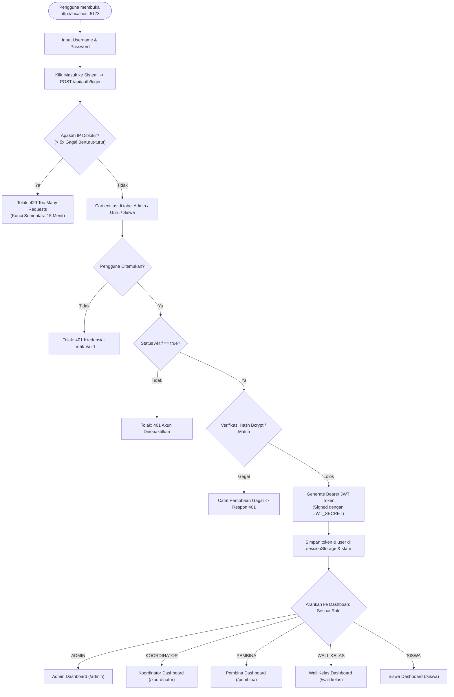
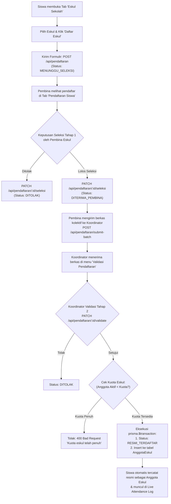
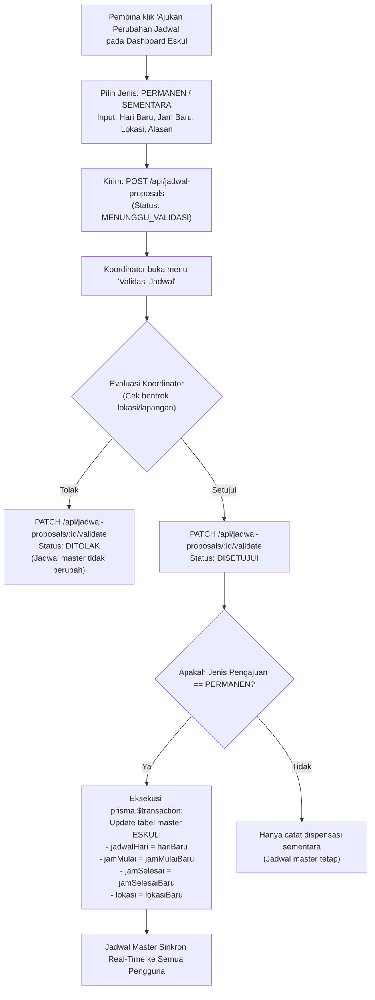
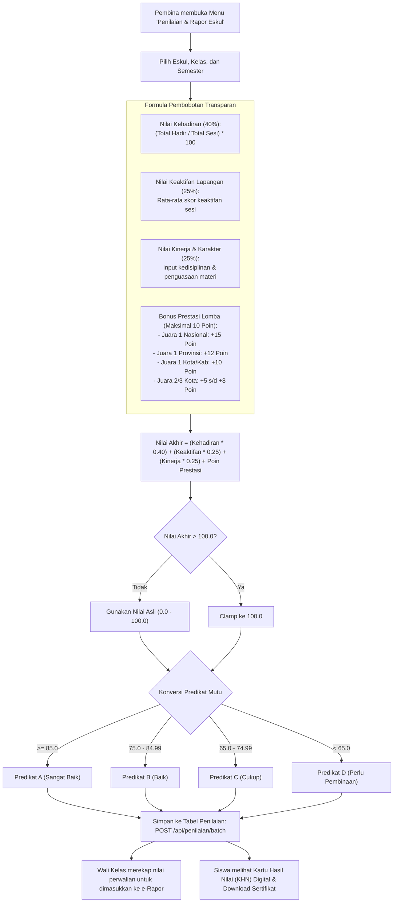
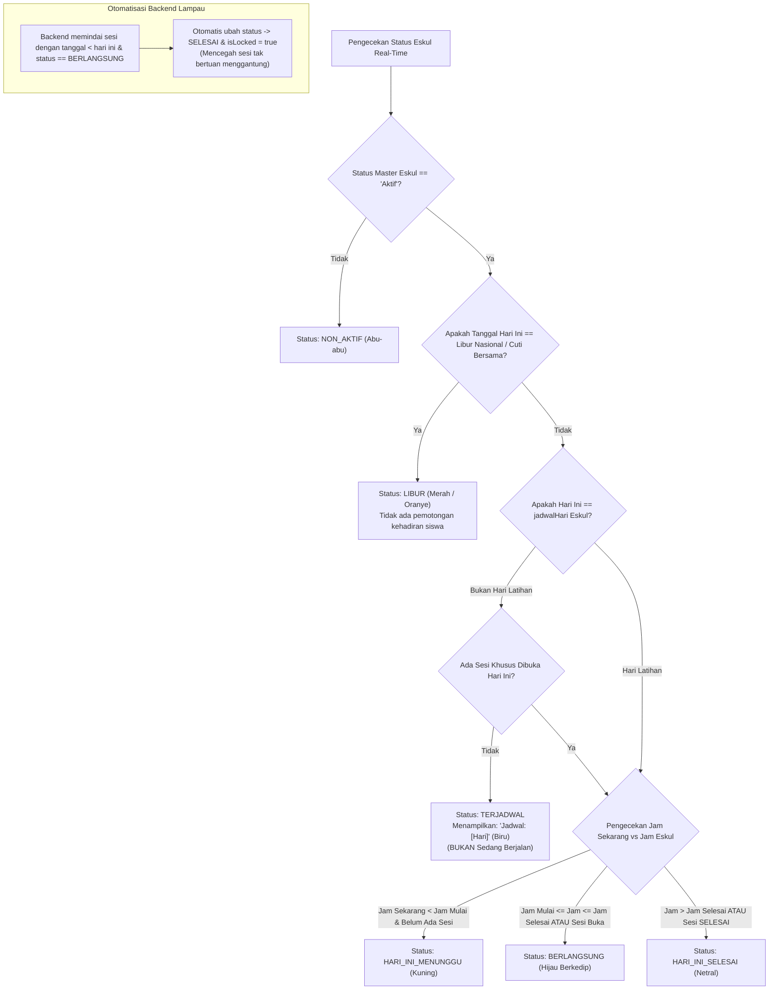

# PANDUAN ALUR SISTEM & KATALOG PENGUJIAN QUALITY CONTROL (QC)
### Sistem Informasi Presensi Dynamic QR & Penilaian Ekstrakurikuler
**SMK Al Amanah Kota Tangerang Selatan**

---

## 1. Ringkasan Ekosistem & Lingkungan Pengujian (System Under Test)

Dokumen ini disusun sebagai panduan operasional komprehensif bagi tim **Quality Assurance (QA) / Quality Control (QC)** dalam memverifikasi integritas alur bisnis, keandalan fungsional, akurasi perhitungan matematis Kurikulum Merdeka, serta pertahanan keamanan siber (OWASP) pada aplikasi Presensi & Ekstrakurikuler SMK Al Amanah.

### 1.1 Topologi Aplikasi & Port Lokal
* **Client Frontend (Web Responsive):** `http://localhost:5173` (React 19 + TypeScript + Vite + Tailwind CSS + Framer Motion)
* **API Backend Server:** `http://localhost:5000` (Node.js Express Native ESM + Prisma ORM)
* **Database Visual Inspector:** `http://localhost:5555` (`npx prisma studio` - Database SQLite lokal `backend/prisma/dev.db`)
* **API Base Endpoint:** `http://localhost:5000/api`

### 1.2 Akun Uji QC Resmi (Test Credentials Matrix)

| Role | Username / ID | Password Default | Nama Representasi Pengguna | Hak Akses Utama & Cakupan Pengujian |
| :--- | :--- | :--- | :--- | :--- |
| **`ADMIN`** | `admin` | `admin123` | Administrator Sistem | Konfigurasi sistem, geofencing, kelola master kelas/guru/siswa/eskul, audit log. |
| **`KOORDINATOR`** | `koordinator` | `pembina123` | Viska Adawiyah | Validasi Tahap 2 perubahan jadwal, Validasi Tahap 2 pendaftaran anggota, rekap lintas eskul. |
| **`PEMBINA`** (Futsal) | `ahmad.futsal` | `pembina123` | Ahmad Syafii | Buka sesi Dynamic QR Futsal, Mode Guru Scanner, Seleksi Tahap 1 anggota, input nilai 4-komponen, ajukan jadwal. |
| **`PEMBINA`** (Web Club)| `abdul.jabbar` | `pembina123` | Abdul Jabbar | Uji isolasi IDOR: Dilarang memodifikasi sesi atau anggota Futsal. |
| **`WALI_KELAS`** | `walikelas` | `walikelas123` | Dra. Hj. Siti Aminah (X RPL 1) | Monitoring kehadiran siswa perwalian, ekspor & review nilai e-Rapor perwalian. |
| **`SISWA`** | `241011400049` | `siswa123` | Khaisan Ramzi Muzhaffar (X RPL 1) | Pendaftaran eskul, scan dynamic QR via kamera, Kartu Siswa Digital QR, cek nilai rapor KHN. |
| **`SISWA` (Alt)** | `241011403038` | `al_amanah_038`| M. Ariono Putra Agusni (X RPL 1) | Uji presensi ganda, riwayat kehadiran, dan kartu siswa. |

---

## 2. Peta Alur Bisnis Sistem (End-to-End Workflows)

Berikut adalah diagram alur proses bisnis utama yang wajib diuji oleh tim QC:

### ALUR 1: Autentikasi, Session Restore, & Pertahanan Akses (RBAC)

Alur ini memvalidasi keamanan pintu masuk aplikasi, retensi login saat browser di-refresh, dan penolakan akun tidak sah.



> [!NOTE]
> **QC Verifikasi Session Persistence:** Ketika pengguna berada di dalam dashboard lalu melakukan *Hard Refresh* browser (F5), frontend secara otomatis memanggil `GET /api/auth/me` menggunakan token yang tersimpan di `sessionStorage`. State tidak boleh logout jika token masih valid.

---

### ALUR 2: Pendaftaran Anggota Ekstrakurikuler (Two-Tier Governance)

Alur pendaftaran peserta didik baru melalui mekanisme persetujuan bertingkat (*two-tier approval*) dan validasi kuota otomatis.



---

### ALUR 3: Pengajuan & Validasi Perubahan Jadwal Eskul (Two-Tier Governance)

Alur pembina mengajukan perubahan hari, jam, atau lokasi eskul dan disetujui koordinator dengan sinkronisasi basis data otomatis secara atomik.



---

### ALUR 4: Presensi Real-Time Dynamic Rolling QR (3 Mode Scanning)

Inti dari pencegahan titip absen menggunakan Dynamic QR berputar tiap 15 detik, pembatasan radius GPS Geofencing, dan fallback 4-tahap.

```mermaid
flowchart TD
    subgraph SesiSetup ["1. Persiapan Sesi Latihan"]
        B1["Pembina klik 'Buka Sesi Absensi'"] --> B2["Input Judul, Tanggal, Jam, Deskripsi"]
        B2 --> B3["POST /api/sessions -> Status: BERLANGSUNG\nToken Rolling Pertama Dibuat"]
    end

    subgraph ModeA ["2. Mode A: Dynamic QR Mandiri Siswa (Self-Service)"]
        QR_Loop["Frontend Pembina me-refresh QR Code setiap 15 Detik\nFormula: SMK-AMANAH:eskulId:window:salt\nProgress Bar Berputar Realtime"]
        
        S_Scan["Siswa buka kamera scanner di HP (/siswa/scan)"] --> S_Detect["Kamera deteksi Dynamic QR Pembina"]
        S_Detect --> S_Post["Kirim Payload: POST /api/presensi/scan\n{ qrToken, siswaId, lat, lon }"]
        
        S_Post --> GeoCheck{"Geofencing Check:\nJarak Haversine <= 150m?"}
        GeoCheck -->|"Di luar 150m"| GeoErr["Tolak: 403 Forbidden\n'Anda berada di luar area sekolah'"]
        GeoCheck -->|"Dalam radius"| TokenCheck{"Token Window Check:\nToken aktif t0 atau toleransi t-1\n(Maksimal 30 detik?)"}
        
        TokenCheck -->|"Expired > 30s"| TokErr["Tolak: 400 Bad Request\n'Kode QR Kedaluwarsa, silakan scan ulang'"]
        TokenCheck -->|"Valid"| DupCheck{"Sudah Tercatat HADIR pada sesi ini?"}
        
        DupCheck -->|"Sudah Hadir"| DupErr["Tolak: 400 Bad Request\n'Siswa sudah tercatat HADIR'"]
        DupCheck -->|"Belum"| MarkHadir["Catat Status: HADIR\nMetode: DYNAMIC_QR\nTrigger Canvas Confetti Hijau! 🎉"]
    end

    subgraph ModeB ["3. Mode B: Guru Scan Kartu Siswa (Fallback Kuota/Baterai)"]
        Card["Siswa bawa Kartu Digital / Fisik (QR NIS Siswa)"]
        Card --> T_Scan["Pembina buka menu 'Teacher Scanner'"]
        T_Scan --> T_Post["POST /api/presensi/teacher-scan { nis, sesiId }"]
        T_Post --> T_Mark["Catat Status: HADIR (Metode: SCAN_QR_SISWA)"]
    end

    subgraph ModeC ["4. Mode C: Checklist Manual 4-Tahap & Lock Sesi"]
        M1["Tahap 1: Checklist Hadir massal"] --> M2["Tahap 2: Input Keaktifan Lapangan (Skor 1-100)"]
        M2 --> M3["Tahap 3: Pendataan Izin & Sakit (Bukti Surat)"]
        M3 --> M4["Tahap 4: Finalize & Lock Session\nPOST /api/sessions/:id/finalize"]
        M4 --> Locked["Sesi Terkunci (isLocked = true, status = SELESAI)\nData presensi tidak dapat dimanipulasi lagi"]
    end
```



---

### ALUR 5: Penilaian Akhir Semester e-Rapor & Prestasi Lomba

Perhitungan otomatis nilai akhir semester berbasis Kurikulum Merdeka dengan pembobotan 4-komponen dan konversi predikat huruf.



---

### ALUR 6: State Machine Status Eskul & Auto-Finalize Sesi Lampau

Memastikan badge status eskul pada dashboard selalu akurat sesuai jadwal aktual dan hari libur nasional.



---

## 3. Matriks Skenario Uji Quality Control (QC Test Catalog)

Tabel berikut berisi **27 skenario pengujian komprehensif** yang mencakup pengujian Positif (Happy Path), Negatif (Error Handling), Nilai Batas (Boundary Value), dan Keamanan (OWASP/IDOR):

| ID Uji | Modul | Tipe Uji | Langkah Pengujian (Aksi QC) | Ekspektasi Hasil Sistem | Kriteria Lolos (Pass) |
| :--- | :--- | :--- | :--- | :--- | :--- |
| **TC-AUTH-01** | Autentikasi | Positif | Login menggunakan kredensial ke-5 role (`admin`, `koordinator`, `ahmad.futsal`, `walikelas`, `241011400049`). | Response `200 OK`, mengembalikan Bearer JWT dan objek profil pengguna. UI berpindah ke dashboard masing-masing role. | Token tersimpan di `sessionStorage` dan header auth terpasang. |
| **TC-AUTH-02** | Autentikasi | Negatif | Login dengan akun non-aktif (`admin.inactive`). | Server merespon `401 Unauthorized` dengan pesan akun dinonaktifkan. Form login bergetar (*shake animation*). | Login diblokir; tidak ada JWT token yang dikeluarkan. |
| **TC-AUTH-03** | Autentikasi | Negatif / Keamanan | Masukkan password salah 5 kali berturut-turut pada akun yang sama. | Server mengembalikan `429 Too Many Requests` setelah percobaan ke-5, memblokir request selama 15 menit. | Pesan lockout tampil jelas dan brute-force tertahan. |
| **TC-AUTH-04** | Autentikasi | Positif | Login sebagai `admin`, lalu tekan F5 (Hard Refresh) di browser. | Frontend memanggil `GET /api/auth/me`. Dashboard tetap aktif tanpa mental ke halaman login. | State login persisten tanpa re-login. |
| **TC-REG-01** | Pendaftaran | Positif | Login sebagai Siswa (`241011400049`), pilih eskul "English Club", isi alasan, klik Kirim. | Pendaftaran tersimpan dengan status `MENUNGGU_SELEKSI`. Siswa melihat status menunggu di dashboardnya. | Record baru muncul di tabel `PendaftaranEskul`. |
| **TC-REG-02** | Pendaftaran | Positif | Login sebagai Pembina English Club, buka menu pendaftaran, klik tombol "Terima". | Status berubah menjadi `DITERIMA_PEMBINA`. Tombol kirim batch berkas ke Koordinator aktif. | Status terupdate di backend. |
| **TC-REG-03** | Pendaftaran | Positif | Login sebagai Koordinator, klik "Validasi Resmi" pada calon anggota yang lolos tahap 1. | Status berubah menjadi `RESMI_TERDAFTAR`. Record baru otomatis masuk ke tabel `AnggotaEskul`. | Transaksi Prisma berhasil; nama siswa muncul di daftar anggota. |
| **TC-REG-04** | Pendaftaran | Negatif / Boundary | Set kuota eskul = 2 di database. Daftarkan dan setujui siswa ke-3. | Server merespon `400 Bad Request` dengan pesan "Kuota eskul telah penuh". Persetujuan dibatalkan. | Kuota tidak terlampaui (*prevent over-subscription*). |
| **TC-SCHED-01** | Jadwal | Positif | Pembina Futsal mengajukan perubahan hari latihan dari "Kamis" ke "Jumat", jam "16:00". | Proposal tersimpan dengan status `MENUNGGU_VALIDASI`. Notifikasi muncul di akun Koordinator. | Master jadwal eskul saat ini belum berubah. |
| **TC-SCHED-02** | Jadwal | Positif | Koordinator menyetujui proposal perubahan jadwal permanen di atas. | Proposal berstatus `DISETUJUI`. Tabel master `Eskul` (Futsal) otomatis terupdate: hari = Jumat, jam = 16:00. | Sinkronisasi database terjadi secara atomik (`prisma.$transaction`). |
| **TC-SCHED-03** | Jadwal | Negatif | Koordinator menolak proposal perubahan jadwal dengan alasan "Lapangan bentrok". | Proposal berstatus `DITOLAK`. Jadwal master `Eskul` tetap pada hari Kamis (tidak berubah). | Catatan alasan penolakan tersimpan di log proposal. |
| **TC-QR-01** | Presensi QR | Positif | Pembina membuka sesi latihan baru. Amati tampilan Dynamic QR di layar laptop pembina. | QR Code berganti setiap 15 detik. Indikator progress bar lingkaran menyusut dan ter-reset setiap 15s. | Token payload menyertakan timestamp window dan salt dinamis. |
| **TC-QR-02** | Presensi QR | Positif | Siswa scan Dynamic QR pembina dalam radius < 150m dari titik koordinat sekolah (-6.34215, 106.71124). | Respon `200 OK`. Muncul efek konfeti hijau di HP siswa. Nama siswa muncul instan di monitor pembina. | Status presensi = `HADIR`, metode = `DYNAMIC_QR`. |
| **TC-QR-03** | Presensi QR | Negatif / Anti-Titip | Ambil foto QR pembina, tunggu lebih dari 30 detik, lalu scan dari HP lain. | Server merespon `400 Bad Request`: "Kode QR Kedaluwarsa, silakan scan ulang QR terbaru pada layar pembina." | Presensi ditolak; tangkapan layar/foto WA tidak valid. |
| **TC-QR-04** | Presensi QR | Negatif | Siswa yang sudah sukses absen mencoba men-scan QR yang sama untuk kedua kalinya. | Server merespon `400 Bad Request`: "Siswa sudah tercatat HADIR pada sesi ini" (`isDuplicate: true`). | Tidak terjadi duplikasi pencatatan absensi. |
| **TC-QR-05** | Presensi QR | Negatif / Security | Mock lokasi GPS siswa pada jarak 500 meter dari sekolah, lalu lakukan submit scan. | Server merespon `403 Forbidden`: "Lokasi Anda berada di luar radius presensi sekolah (Maksimal 150 meter)." | Haversine formula backend memblokir presensi dari rumah. |
| **TC-SCAN-01** | Presensi QR | Positif | Siswa tanpa HP membawa Kartu Siswa Digital. Pembina memindai barcode NIS siswa via menu Teacher Scanner. | Respon `200 OK`. Siswa tercatat `HADIR` dengan metode pencatatan `SCAN_QR_SISWA`. | Fallback Mode B berhasil tanpa HP siswa. |
| **TC-MAN-01** | Presensi | Positif | Pembina menggunakan Fallback Mode C: Checklist manual kehadiran, input keaktifan, dan izin/sakit. | Seluruh data siswa tersimpan sesuai status masing-masing (`HADIR`, `IZIN`, `SAKIT`, `ALPA`). | Nilai keaktifan tersimpan di tabel presensi. |
| **TC-MAN-02** | Presensi | Positif / Boundary | Pembina menekan tombol "Finalize & Kunci Sesi". Coba ubah data setelah sesi berstatus `SELESAI`. | Sesi terkunci (`isLocked: true`). Upaya manipulasi data presensi pada sesi terkunci ditolak `400 Bad Request`. | Integritas data absensi terjamin dari perubahan susulan. |
| **TC-SCORE-01** | Penilaian | Positif | Uji formula penilaian siswa dengan Hadir=100%, Keaktifan=80, Kinerja=90, tanpa prestasi. | Perhitungan: $(100 \times 0.40) + (80 \times 0.25) + (90 \times 0.25) = 40 + 20 + 22.5 = \mathbf{82.5}$. Predikat: **B**. | Skor akhir tepat 82.50 dan predikat "B (Baik)". |
| **TC-SCORE-02** | Penilaian | Positif | Tambahkan data prestasi: "Juara 1 Lomba Web Design Tingkat Provinsi (+12 Poin)" pada siswa di atas. | Nilai Baru: $82.5 + 12 = \mathbf{94.5}$. Predikat otomatis naik menjadi **A**. | Bonus poin langsung terinjeksi dan predikat ter-update. |
| **TC-SCORE-03** | Penilaian | Boundary | Uji batas ambang nilai (*boundary values*): 85.0 vs 84.99; 75.0 vs 74.99; 65.0 vs 64.99. | 85.00 menghasilkan **A**, 84.99 menghasilkan **B**. 75.00 menghasilkan **B**, 74.99 menghasilkan **C**. 65.00 -> **C**, 64.99 -> **D**. | Boundary logic Kurikulum Merdeka valid tanpa *rounding bias*. |
| **TC-SCORE-04** | Penilaian | Boundary | Uji skor total yang melebihi 100 (misal: Nilai dasar 95 + Bonus Juara 1 Nasional +15 = 110). | Sistem melakukan clamping otomatis. Nilai Akhir disimpan maksimal **100.0**. | Nilai rapor tidak melebihi skala maksimum 100. |
| **TC-SEC-01** | Keamanan OWASP | Negatif / Security | Login sebagai Pembina Web Club (`abdul.jabbar`), kirim request manipulasi nilai eskul Futsal via Postman/Fetch. | Server merespon `403 Forbidden`: "Akses ditolak: Anda bukan pembina resmi eskul ini." (Anti-IDOR Guard). | Pembina tidak bisa merusak/mengubah data eskul guru lain. |
| **TC-SEC-02** | Keamanan OWASP | Positif / Security | Akses endpoint `GET /api/students` menggunakan token role `SISWA` atau `PEMBINA`. | Data siswa tampil, namun atribut `defaultPassword` dan `passwordHash` otomatis di-strip (*null / undefined*). | Kredensial siswa tidak bocor ke publik atau role lain. |
| **TC-SEC-03** | Keamanan OWASP | Negatif / Security | Upload file bukti izin dengan ekstensi terlarang: `script.php` atau `malware.exe`. | Server merespon `400 Bad Request`: "Tipe file tidak diizinkan. Hanya menerima .pdf, .png, .jpg." | Multer whitelist memblokir upload berbahaya (*Anti-Webshell*). |
| **TC-STATE-01** | Status Eskul | Positif | Akses dashboard eskul pada hari Kamis untuk eskul Futsal (jadwal Kamis 15:30) vs Web Club (Jumat). | Futsal menampilkan status `HARI_INI_MENUNGGU` atau `BERLANGSUNG`. Web Club menampilkan badge `Jadwal: Jumat`. | Status tidak salah mengabarkan bahwa Web Club sedang berjalan. |

---

## 4. Panduan Eksekusi Pengujian Step-by-Step

### 4.1 Persiapan Lingkungan Uji (Clean Slate Setup)
Sebelum memulai siklus QC penuh, pastikan database di-reset ke kondisi standar:
```bash
# Terminal Root Project:
npm run db:seed
```
*Hasil:* Database terisi dengan 12 cabang eskul resmi, 5 akun role, 30+ siswa kelas X, sesi latihan contoh, dan rekap nilai bawaan.

### 4.2 Menjalankan Automated Regression Test Suite
Jalankan suite tes otomatis untuk memverifikasi kesehatan seluruh endpoint dan logika backend:
```bash
cd backend
npm test
```
> [!IMPORTANT]
> **Standar Kelulusan QC:** Seluruh **43 pengujian otomatis** wajib berstatus **PASS (100% Hijau)** tanpa ada `FAIL` atau `cancelled`.

### 4.3 Menjalankan Aplikasi untuk Pengujian Manual UI
```bash
# Terminal Root Project:
npm run dev
```
Buka browser pada:
* Frontend: `http://localhost:5173`
* Backend Health: `http://localhost:5000/api/settings`
* Database Studio: `http://localhost:5555` (buka terminal baru: `npm run db:studio`)

---

## 5. Template Formulir Temuan Cacat (Defect Report)

Gunakan format standar berikut jika tim QC menemukan bug atau inkonsistensi sistem selama pengujian:

```markdown
### [DEFECT REPORT] #{Nomor-Tiket} - {Judul Singkat Masalah}
* **ID Skenario Uji:** (contoh: TC-QR-05)
* **Tingkat Keparahan (Severity):** [CRITICAL / HIGH / MEDIUM / LOW]
* **Role Pengguna Terkait:** [ADMIN / KOORDINATOR / PEMBINA / WALI_KELAS / SISWA]
* **Modul / Endpoint:** (contoh: `POST /api/presensi/scan`)
* **Lingkungan Uji:** Windows 11 / Chrome v131 / Node.js v20.15

**Langkah Mereproduksi (Steps to Reproduce):**
1. Login sebagai user '...'
2. Buka menu '...'
3. Masukkan data '...'
4. Klik tombol '...'

**Hasil Aktual (Actual Result):**
- Sistem menampilkan error 500 / data tidak tersimpan / status salah.

**Hasil yang Diharapkan (Expected Result):**
- Sistem seharusnya menolak dengan pesan validasi yang jelas atau menyimpan data dengan benar.

**Bukti Pendukung (Evidence):**
- [Tangkapan layar UI / Payload Request-Response Network Tab / Log Terminal]
```
